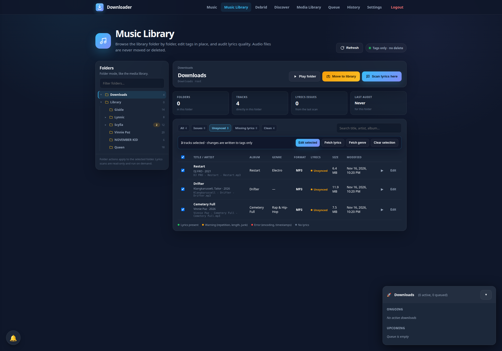
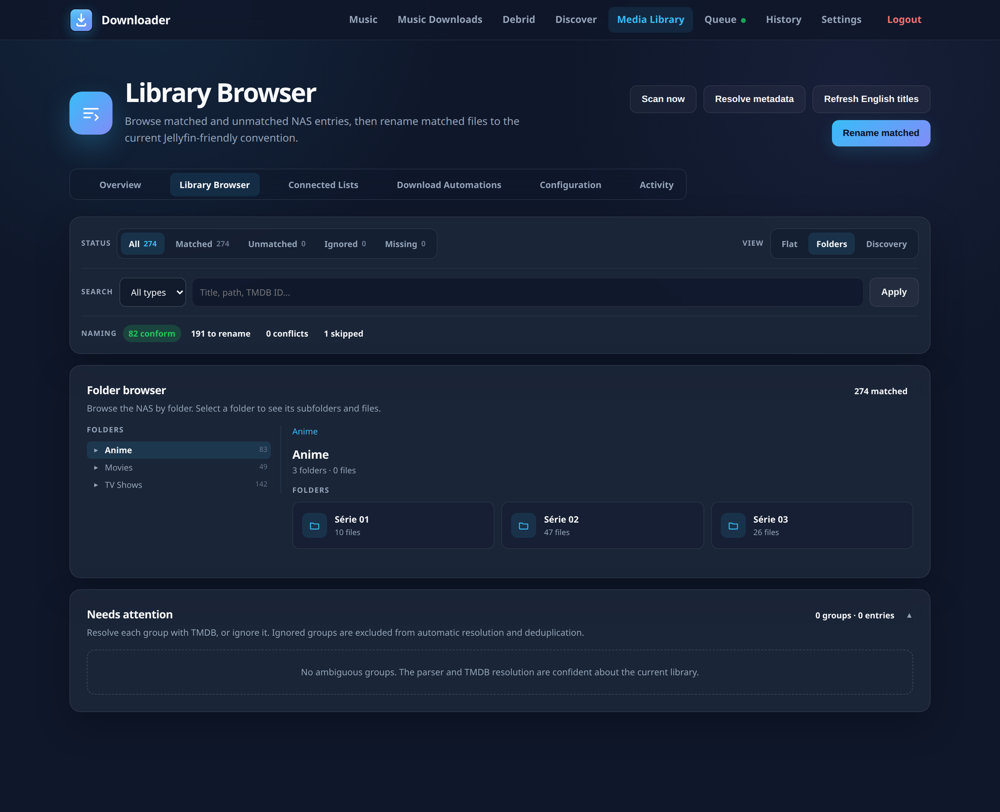
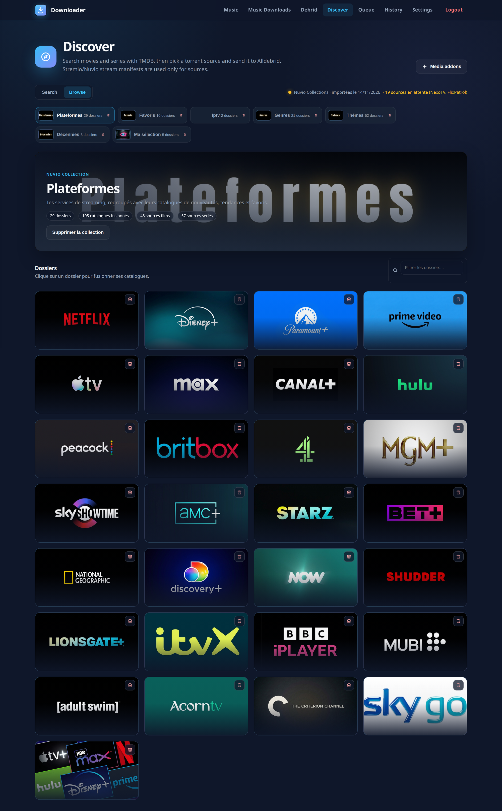
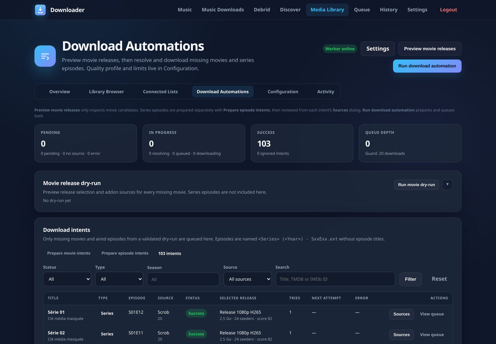

# Downloader

Une plateforme self-hosted de gestion de médias, développée avec Symfony & Python et livrée sous forme d'image Docker unique. Elle gère les téléchargements vidéo, torrents et liens directs via Alldebrid, un pipeline musical complet de la recherche Spotify à la bibliothèque taguée, une interface de découverte TMDB/Stremio, et un moteur d'automatisation qui synchronise votre bibliothèque NAS avec des listes externes.

**Version :** 2.8.1

| Ressource | Lien |
| --------- | ---- |
| Code source de l'application | https://github.com/Gautardos/downloader |
| Déploiement conteneurisé (Docker Compose) | https://github.com/Gautardos/docker-downloader |
| Image Docker | `gautardos/downloader-app` |

---

## ✨ Fonctionnalités

### 🎬 Vidéos, torrents & liens directs
- **Import de magnets et de fichiers `.torrent`** avec débridage cloud Alldebrid.
- **Recherche de torrents** basée sur une base SQLite locale (`hash-db`), avec recherche par titre, catégories et remplissage automatique des magnets.
- **Aperçu des magnets** — vérifiez la liste des fichiers, les tailles et le statut Alldebrid avant de valider.
- **Regroupement en packs** — détection automatique des séries/albums avec création récursive des dossiers.
- **Création de dossiers en lot** — création en un clic de tous les dossiers manquants lors d'un import massif.
- **Liens directs** — envoi d'une liste de liens HTTP dans la file de téléchargement.
- **Renommage assisté par IA** — noms de fichiers propres et normalisés suggérés par le modèle IA configuré (le bouton ✨ est masqué si aucune clé IA n'est configurée).
- **Téléchargements récents** — historique Alldebrid paginé avec réponses mises en cache.

### 🔎 Discover (TMDB + addons)
- **Recherche TMDB** de films et séries, avec détails, saisons et épisodes.
- **Addons Stremio/Nuvio** utilisés comme sources de streams (manifestes HTTPS publics uniquement).
- **Import de collections Nuvio** avec mapping des catalogues/dossiers et activation par addon.
- **Débridage en un clic** — choisissez une source et envoyez le torrent à Alldebrid puis à la file.
- **Affiches et métadonnées TMDB** exposées à la passerelle Jellyfin.

### 🎵 Musique
- **Recherche Spotify** de titres, albums et playlists, y compris les playlists privées via le token librespot.
- **Téléchargements haute qualité** propulsés par Zotify. **Auto** (défaut) utilise la meilleure qualité autorisée par votre compte Spotify : **320 kbps avec Premium**, **160 kbps avec un compte gratuit**. 320 kbps nécessite Premium.
- **Music Library unifiée** — parcourez les racines `Downloads` (`music_root_path`) et `Library` (`music_library_path`) dans un seul arbre de dossiers.
- **Éditeur de tags complet** — titre, artiste, album, album artist, année, genre, numéros de piste/disque, commentaire et lyrics embarquées, à l'unité ou en masse.
- **Lyrics** — LRCLIB (recherche synchronisée et scorée), Genius et fallback lyrics.ovh, récupération par piste ou par lot.
- **Audit des lyrics** — détection en lecture seule par dossier : encodage, timestamps, contenu parasite, répétitions, longueur anormale et lyrics manquantes.
- **Classification de genres par IA** — modèle et prompt configurables, complétés par un mapping regex.
- **Automatisation de la bibliothèque** — déplacement, renommage et organisation dans `Artiste/Artiste - Album - Piste - Titre.ext`.
- **Lecteur audio simple** — lecture d'une piste ou du dossier courant avec seek, volume et file d'attente.
- **Authentification Spotify** — génération des credentials depuis les Settings via le binaire `librespot-auth` intégré.

### 🤖 Automations (bibliothèque NAS)
- **Index de la bibliothèque** pour les racines Films, Séries et Anime, avec scans incrémentaux et support NFO.
- **Library Browser** — vues Flat, Folders et Discovery avec métadonnées TMDB, affiches et statut de nommage.
- **Résolution des métadonnées** — associez les entrées ambiguës à TMDB, corrigez un match manuellement ou ignorez des groupes.
- **Renommage Jellyfin** — prévisualisez et appliquez le nommage `Titre (Année)` / `SxxExx`, avec gestion des sidecars et annulation.
- **Connected Lists** — import des listes Scrob et MDBList, dry-run de matching contre le NAS et mise en ignore.
- **Profil qualité** — résolution, codecs, HDR, langues audio, seeders, limites de taille et priorité des addons.
- **Téléchargements automatiques** — création d'intents pour les films et épisodes manquants, résolution des releases, envoi à Alldebrid et suivi du statut.
- **Numérotation des séries** — alignement des épisodes TMDB avec la numérotation TVDB/Cinemeta/TVmaze/AIOMetadata.
- **Dry-run** — prévisualisez la sélection des releases sans contacter Alldebrid ni mettre en file.
- **Activity** — historique des scans, résolutions, listes et intents.
- **Aide intégrée** — un guide complet est disponible sur `/automation/help`.

### 📺 Jellyfin / Nuvio
- **API compatible Jellyfin** sous `/jellyfin`, en lecture seule et direct-play uniquement.
- **Intégration Nuvio** — ajoutez `http://<hôte>:8000/jellyfin` comme serveur Jellyfin (l'URL racine redirige aussi la découverte).
- **Reprise de lecture, statut vu/non vu, recherche, affiches TMDB et sous-titres externes.**

### 🛠️ Système
- **File de téléchargement** — traitement séquentiel via un worker en arrière-plan (géré par Supervisor).
- **Worker d'automation** — scans, synchronisations de listes et intents de releases en arrière-plan.
- **Worker de maintenance** — mise à jour de la base torrents, rotation des logs et contrôles d'intégrité planifiés.
- **Worker d'automatisations musicales** — suit des playlists Spotify et ajoute les pistes manquantes.
- **Recherche globale** — une palette (`Ctrl/Cmd+K`) sur les actions, torrents, historique, TMDB et Spotify.
- **Statistiques** — tableau de bord d'activité (`7j` / `30j` / `90j` / tout) avec export CSV.
- **Intégrité vidéo** — détecte les téléchargements tronqués, corrompus ou manquants et peut les remettre en file.
- **PWA & Web Push** — application installable, page hors-ligne, notifications VAPID pour téléchargements, erreurs, automatisations et intégrité.
- **Tracker temps réel** — progression en direct avec polling et notifications navigateur.
- **Historique complet** — journaux détaillés avec limite de rétention configurable.
- **Authentification** — login simple avec identifiants configurables (défaut : `admin` / `admin`) et protection CSRF.
- **Fournisseur IA** — OpenRouter (par défaut) avec fallback xAI et un modèle par usage (défaut, renommage, genre musical).
- **UI adaptative** — les éléments de navigation sont masqués automatiquement quand leurs dépendances ne sont pas configurées.
- **Stockage fichier** — JSON pour la configuration/file/historique, SQLite pour torrents, automatisations, maintenance, intégrité, règles musicales et abonnements PWA ; aucun serveur SQL externe requis.

---

## 📸 Captures d'écran

| Music Library | Automations — Library Browser |
| ------------- | ----------------------------- |
|  |  |

| Discover | Automations — Downloads |
| -------- | ----------------------- |
|  |  |

---

## 🐳 Installation (Docker)

L'application est distribuée sous forme d'image Docker préconstruite. Le déploiement recommandé passe par le dépôt Compose dédié : **https://github.com/Gautardos/docker-downloader**.

### Prérequis

- **Docker** et **Docker Compose v2** sur un hôte Linux (ou Docker Desktop sur Windows/macOS).
- Un compte **Alldebrid** pour les fonctionnalités vidéo/torrents.
- Un compte développeur **Spotify** et une session Spotify pour la musique.
- Optionnel : une clé API **TMDB** (Discover), une clé **OpenRouter** ou **xAI** (fonctions IA), des identifiants **Scrob/MDBList** (Automations), un client **Jellyfin/Nuvio** (streaming).
- **HTTPS** (ou `localhost`) pour la PWA : l'installation, le service worker et le Web Push exigent un contexte sécurisé. Du HTTP simple sur une IP du LAN ne les activera pas.

> [!IMPORTANT]
> Le fichier Compose utilise `network_mode: host`. Sous Docker Desktop pour Windows, cela nécessite **Docker Desktop ≥ 4.34** avec des conteneurs Linux (voir la section Windows du [dépôt conteneur](https://github.com/Gautardos/docker-downloader)).

### 1. Récupérer les fichiers Compose

```bash
git clone https://github.com/Gautardos/docker-downloader.git ~/downloader-app
cd ~/downloader-app
cp .env.example .env
```

### 2. Créer les répertoires de données

```bash
mkdir -p var/{db,home,storage}
mkdir -p downloads music nas
sudo chown -R 1000:1000 var downloads music nas
```

- `var/db/` — bases SQLite (recherche torrents, index d'automation, maintenance, intégrité, automatisations musicales, abonnements push PWA).
- `var/home/` — home persistant (credentials Spotify, archive Zotify).
- `var/storage/` — configuration, file d'attente, historique, logs, caches et paire de clés VAPID.
- `downloads/`, `music/`, `nas/` — points de montage médias. Adaptez-les à vos disques ou partages NFS/SMB.

The application processes run as UID 1000 inside the container: data and media directories must be writable by that UID (on network shares, by the UID the share maps writes to).

### 3. Configurer `.env`

```env
IMAGE_TAG=latest
PORT=8000
DATA_DIR=./var
DOWNLOADS_DIR=./downloads
MUSIC_DIR=./music
NAS_DIR=./nas
```

Utilisez une version explicite (par exemple `IMAGE_TAG=2.8.1`) pour un déploiement reproductible. Les chemins sont des chemins **hôte** ; ils sont montés vers des chemins conteneur fixes.

> [!NOTE]
> L'image sert le HTTP sur le port **8000**. Conservez `PORT=8000` sauf si vous personnalisez l'image ; avec `network_mode: host`, l'application est accessible sur ce port.

### 4. Créer le secret applicatif

Les secrets ne doivent jamais être stockés dans le fichier Compose ni dans `.env`. Create this file before the first start: if it is missing, Docker creates a directory with that name instead. Créez `var/.env.local` :

```bash
printf 'APP_ENV=prod\nAPP_DEBUG=0\nAPP_SECRET=%s\n' "$(openssl rand -hex 32)" > var/.env.local
chmod 600 var/.env.local
```

Ce fichier est monté en lecture seule sur `/var/www/html/.env.local`. The file must be owned by UID 1000.

### 5. Démarrer le conteneur

```bash
cd ~/downloader-app
docker compose up -d
```

L'application est alors accessible à l'adresse **`http://<votre-ip>:8000`**.

<details>
<summary>Référence du fichier Compose (déjà fourni dans le dépôt conteneur)</summary>

```yaml
services:
  downloader:
    image: gautardos/downloader-app:${IMAGE_TAG:-latest}
    container_name: downloader-container
    network_mode: host
    environment:
      - PORT=${PORT:-8000}
    volumes:
      - ${DATA_DIR:-./var}/.env.local:/var/www/html/.env.local:ro
      - ${DATA_DIR:-./var}/db:/var/www/html/var/db
      - ${DATA_DIR:-./var}/home:/var/www/html/var/home
      - ${DATA_DIR:-./var}/storage:/var/www/html/var/storage
      - ${DOWNLOADS_DIR:-./downloads}:/downloads
      - ${MUSIC_DIR:-./music}:/music
      - ${NAS_DIR:-./nas}:/nas
    restart: unless-stopped
    logging:
      driver: "json-file"
      options:
        max-size: "10m"
        max-file: "3"
```

</details>

### 6. Première connexion

Ouvrez l'application dans votre navigateur. Identifiants par défaut :

| Champ        | Valeur  |
| ------------ | ------- |
| Utilisateur  | `admin` |
| Mot de passe | `admin` |

> [!TIP]
> Change these before exposing the application outside your LAN (it listens on all interfaces with network_mode: host). Put it behind a reverse proxy with HTTPS for remote access.

### Windows

Le dépôt conteneur contient un guide Windows dédié (version de Docker Desktop requise, host networking, chemins PowerShell et syntaxe des volumes). En résumé :

1. Créez les répertoires de données (`var\db`, `var\home`, `var\storage`) sous `%USERPROFILE%\downloader-app`.
2. Copiez `.env.example` vers `.env` et adaptez les chemins de lecteurs (par exemple `D:\downloads`).
3. Lancez `docker compose up -d` depuis PowerShell.

Si le host networking n'est pas disponible, remplacez `network_mode: host` par `ports: ["8000:8000"]`.

### Mise à jour

```bash
cd ~/downloader-app
docker compose pull
docker compose up -d
```

Pour épingler une version, définissez `IMAGE_TAG=<version>` dans `.env` avant le pull. No manual migration is required between 2.x versions; coming from 1.x, see Upgrading from 1.x. Existing storage paths keep working.

To roll back, set the previous `IMAGE_TAG` and run the same commands.

> [!NOTE]
> With the legacy docker-compose v1, run `docker-compose down` before `docker-compose up -d` after a pull.

### Upgrading from 1.x

Use the Compose file from docker-downloader; stop mounting `src/` and `templates/` (the code is in the image); create `var/.env.local` (see above); give existing data to UID 1000 (`sudo chown -R 1000:1000 <DATA_DIR>`).

---

## ⚙️ Configuration

Les réglages se font via l'interface web dans **Settings** (`/config`), sauf TMDB/addons (tiroir Discover) et Automations (page dédiée **Automations → Configuration**). Les secrets d'exécution sont décrits dans [`.env` / `.env.local`](#4-créer-le-secret-applicatif).

### 🔑 Clés API & IA

| Réglage | Rôle | Requis pour |
| ------- | ---- | ----------- |
| **Alldebrid API Key** | Débridage et téléchargement de torrents/magnets | Vidéos, torrents, Discover |
| **AI Provider** | `openrouter` (défaut) ou `xai` | Fonctions IA (optionnel) |
| **OpenRouter API Key** | Renommage IA, détection de genres et autres usages IA | Fonctions IA (optionnel) |
| **Modèles Default / Renaming / Music genre** | Modèle par usage, choisi dans le catalogue OpenRouter | Fonctions IA |
| **xAI API Key** | Fournisseur de fallback quand aucune clé OpenRouter n'est définie | Fonctions IA (optionnel) |
| **Spotify Client ID / Secret** | Recherche de métadonnées via l'API Spotify | Recherche musicale |
| **Genius API Token** | Lyrics en texte brut | Lyrics (optionnel) |
| **LRCLib Token** | Lyrics LRC synchronisées | Lyrics (optionnel) |
| **TMDB API Key** | Recherche, métadonnées et affiches | Discover, métadonnées Jellyfin (configuré dans le tiroir Discover) |

> [!NOTE]
> Le fournisseur IA est résolu par usage : modèle spécifique à l'usage, puis modèle par défaut, puis fallback xAI. Sans aucune clé IA, les boutons IA sont masqués.

### 📂 Chemins

| Réglage | Défaut (Docker) | Description |
| ------- | --------------- | ----------- |
| **Default Torrent Download Path** | `/downloads` | Emplacement des fichiers torrent/vidéo |
| **Music Download Root** | `/music` | Répertoire temporaire de téléchargement musique (racine `Downloads`) |
| **Library Target Path** | *(vide)* | Bibliothèque musicale finale organisée (racine `Library`), ex. `/nas/Music` |
| **JSON Credentials Path** | `/var/www/html/var/home/.local/credentials.json` | Fichier de credentials Spotify |
| **History Archive File** | `/var/www/html/var/home/log/archive.txt` | Journal des pistes déjà téléchargées |
| **Venv Path** | `/opt/venv` | Environnement virtuel Python (préconfiguré dans Docker) |
| **Music Command Binary** | `zotify` | Outil CLI de téléchargement musical |
| **Librespot Auth Binary** | `/var/www/html/var/librespot-auth/target/release/librespot-auth` | Générateur d'authentification Spotify |

> [!WARNING]
> Tous les chemins des Settings sont des chemins **internes au conteneur**. Avec `NAS_DIR=./nas` monté sur `/nas`, utilisez `/nas/...` dans Automations — jamais le chemin hôte.

### 🎵 Musique

| Réglage | Défaut | Description |
| ------- | ------ | ----------- |
| **Output Template** | `{artist} - {album} - {song_name}.{ext}` | Modèle de nommage des fichiers |
| **Format** | `mp3` | Format de sortie (`mp3`, `flac`, `m4a`, `opus`) |
| **Quality** | `auto` | `auto` = meilleur autorisé (320 Premium / 160 gratuit) ; `normal` = 96 kbps ; `high` = 160 kbps ; `very_high` = 320 kbps (Premium uniquement) |
| **Skip Existing** | Désactivé | Ignore les pistes déjà présentes dans l'archive |
| **Download Lyrics** | Activé | Récupère et embarque les lyrics avec Zotify |
| **Retry Attempts** | `3` | Nombre de tentatives réseau |
| **Genre Tagging Mode** | `AI` | `AI` (OpenRouter/xAI) ou `Mapping` (regex) |
| **Use Spotify artist genres** | Activé | Utilise les genres Spotify comme signal avant l'IA |
| **Regex Genre Mapping** | — | JSON `{"genre_patterns": {"regex": "Genre"}}` |

### 🔐 Admin

| Réglage | Défaut | Description |
| ------- | ------ | ----------- |
| **Admin User** | `admin` | Identifiant de connexion |
| **Admin Password** | `admin` | Mot de passe de connexion |
| **History Retention** | `500` | Nombre maximum d'entrées conservées dans l'historique |

### 🎬 Jellyfin / Nuvio

| Réglage | Défaut | Description |
| ------- | ------ | ----------- |
| **Enable Jellyfin API** | Désactivé | Expose la bibliothèque Automation sous `/jellyfin` |
| **Server Name** | `Downloader` | Nom affiché dans Nuvio |
| **Jellyfin Username** | `jellyfin` | Identifiant dédié à Nuvio |
| **Jellyfin Password** | *(vide)* | Mot de passe dédié ; la connexion est désactivée tant qu'il est vide |

Dans Nuvio, ajoutez un serveur Jellyfin avec l'adresse `http://<votre-hôte>:8000/jellyfin` (ou simplement `http://<votre-hôte>:8000`, qui redirige l'endpoint de découverte) et les identifiants dédiés. Lancez d'abord un scan de bibliothèque depuis Automations si l'index est vide.

### 🤖 Automations

Configuré dans **Automations → Configuration** (stocké dans `var/db/automation.db`, pas dans `config.json`) :

- **Racines de bibliothèque et scanner** — chemins films, séries et anime sous `/nas`, intervalle de scan, parsing NFO.
- **Profil qualité** — ordre des résolutions, codecs, HDR, langues audio, seeders minimum, taille max film/épisode, tags exclus, priorité des addons.
- **Limites et garde-fous** — nombre max d'intents par run, queue guard, retries/backoff.
- **Connected Lists** — sources Scrob et MDBList, identifiants et sélection des listes (page **Connected Lists**).
- **Métadonnées** — langue des titres, budget de lookups TMDB et cache.

Le guide intégré dans **Automations → Aide** (`/automation/help`) documente le workflow complet.

---

## 🎵 Configuration Spotify

Les fonctionnalités musicales nécessitent deux configurations Spotify indépendantes.

### 1. Identifiants API Spotify (recherche de métadonnées)

1. Ouvrez le [Spotify Developer Dashboard](https://developer.spotify.com/dashboard).
2. Connectez-vous et cliquez sur **Create app**.
3. Renseignez un nom (ex. `Mon Downloader`) et une redirect URI (ex. `http://localhost:8000/callback`).
4. Enregistrez, puis ouvrez **Settings** sur la page de l'application.
5. Copiez le **Client ID** et le **Client Secret** dans les Settings de l'application.

### 2. Authentification Spotify (téléchargements musicaux)

Le moteur de téléchargement a besoin d'une session Spotify valide stockée dans un fichier `credentials.json`.

**Option A — Depuis l'UI (recommandé) :**

1. Allez dans **Settings**.
2. Cliquez sur le bouton **⚡ Auth** à côté de **JSON Credentials Path**.
3. Ouvrez Spotify sur votre téléphone/PC et sélectionnez l'appareil nommé `Speaker <timestamp>` comme sortie (les deux appareils doivent être sur le même réseau).
4. Le fichier de credentials est généré, transformé et stocké automatiquement.

> [!NOTE]
> Le bouton ⚡ Auth n'apparaît que lorsqu'aucun fichier de credentials n'existe au chemin configuré.

**Option B — Manuel (dans le conteneur) :**

```bash
docker exec -it downloader-container bash
export HOME='/var/www/html/var'
cd /var/www/html/var
/var/www/html/var/librespot-auth/target/release/librespot-auth --name "Speaker Manual"
# → Sélectionnez "Speaker Manual" dans Spotify
# → credentials.json est créé dans /var/www/html/var/
```

Copiez ensuite le fichier vers le chemin attendu :

```bash
cp /var/www/html/var/credentials.json /var/www/html/var/home/.local/credentials.json
```

### 3. Qualité audio et type de compte Spotify

Spotify applique la qualité audio côté serveur ; le client ne peut pas débloquer plus que ce que votre compte autorise.

| Compte | Qualité maximale | Réglage recommandé |
| ------ | ---------------- | ------------------ |
| Gratuit | 160 kbps | `auto` ou `high` |
| Premium | 320 kbps | `auto` |

- **Auto** (défaut) sélectionne 320 kbps avec Premium et 160 kbps avec un compte gratuit.
- **Very High** (320 kbps) nécessite Premium. Avec un compte gratuit, le téléchargement échoue avec `Audio key error` / `Failed fetching audio key` ; la tâche est réessayée avant d'échouer.
- **Normal** = 96 kbps, **High** = 160 kbps, **Very High** = 320 kbps.
- Le format de sortie (MP3/FLAC/M4A/Opus) n'augmente pas la qualité source : une source lossy reste lossy, et FLAC ne fait que grossir le fichier.
- Utilisez les credentials du même compte Spotify que celui avec lequel vous téléchargez.

---

## 🔎 Configuration de Discover

1. Ouvrez **Discover** et cliquez sur le tiroir de réglages/addons.
2. Ajoutez une **clé API TMDB** (ou un token v4 en lecture) et choisissez la langue des métadonnées.
3. Ajoutez un ou plusieurs **manifestes d'addons Stremio/Nuvio** (URLs HTTPS publiques uniquement).
4. Importez éventuellement un export JSON de **collections Nuvio** ; les sources sont activées automatiquement quand leur addon est configuré.
5. Recherchez un film/série, choisissez une source, puis envoyez-la à Alldebrid.

---

## 🏗️ Architecture

Le conteneur exécute six services gérés par **Supervisor** :

| Service | Rôle |
| ------- | ---- |
| **Apache** | Sert l'application Symfony sur le port 8000 |
| **Redis** | Stocke les sessions PHP (évite la contention de verrous de session) |
| **Download Worker** | Traite séquentiellement la file de téléchargement (`app:download-worker`) |
| **Automation Worker** | Exécute les scans planifiés, synchronisations de listes et intents de releases (`app:automation-worker`) |
| **Maintenance Worker** | Exécute la planification de maintenance (`app:maintenance --loop`) |
| **Music Automations Worker** | Suit les playlists Spotify (`app:music-automations --loop`) |

Tous les workers écrivent leurs stderr dans `var/storage/logs/*_error.log`. Les
bases `maintenance.db`, `integrity.db`, `music_automations.db` et `pwa.db` sont
créées automatiquement dans `var/db` à la première utilisation.

### Correspondance des volumes

```
Hôte                                    → Conteneur
────────────────────────────────────────────────────────────────
~/downloader-app/var/db                 → /var/www/html/var/db         (SQLite : torrents, automation, maintenance, intégrité, musique, PWA)
~/downloader-app/var/home               → /var/www/html/var/home       (credentials Spotify, archive)
~/downloader-app/var/storage            → /var/www/html/var/storage    (config, file, historique, logs, clés VAPID)
~/downloader-app/downloads              → /downloads                   (sortie torrent/vidéo)
~/downloader-app/music                  → /music                       (téléchargements musique)
~/downloader-app/nas                    → /nas                         (bibliothèque NAS, lecture/écriture)
```

> [!WARNING]
> Les chemins configurés dans Settings et Automations sont des chemins **internes au conteneur**. Si vous montez un répertoire hôte sur `/music`, réglez **Music Download Root** sur `/music` — pas sur le chemin hôte.

---

## 🔧 Fonctionnement d'Alldebrid

L'application n'est **pas** un client BitTorrent. Elle délègue les téléchargements P2P au service cloud [Alldebrid](https://alldebrid.com) :

1. **Soumission** — magnet ou fichier `.torrent` importé via l'UI (Debrid ou Discover).
2. **Téléchargement cloud** — Alldebrid récupère le contenu sur ses serveurs haute vitesse.
3. **Extraction des liens** — l'API renvoie des liens HTTP directs pour chaque fichier une fois prêt.
4. **Débridage** — chaque lien est déverrouillé pour un téléchargement direct à pleine vitesse.
5. **Transfert local** — le worker en arrière-plan télécharge les fichiers dans votre répertoire local.

---

## 📂 Structure du projet

```
src/                → contrôleurs, services, commandes et subscribers Symfony
templates/          → vues Twig (UI)
cli/                → scripts Python (téléchargement, lyrics, tagging/renommage/déplacement, audit)
public/             → point d'entrée web et assets statiques
var/db/             → bases SQLite (recherche torrents, automation)
var/storage/        → données JSON (config, file, historique, caches, logs)
var/home/           → home persistant (credentials Spotify, archive)
Dockerfile          → définition de build du conteneur
docker-entrypoint.sh→ permissions runtime et démarrage
supervisord.conf    → configuration du gestionnaire de processus
```

### Scripts CLI

| Script | Rôle |
| ------ | ---- |
| `music_downloader.py` | Moteur de téléchargement musical (wrapper Zotify, modes verify/tags) |
| `lyrics_fetcher.py` | Récupère et embarque les lyrics (LRCLIB/Genius/lyrics.ovh) |
| `lyrics_audit.py` | Audit des lyrics en lecture seule |
| `tag_rename_move.py` | Tague, renomme et déplace les fichiers vers la bibliothèque organisée |
| `spotify_user.py` | Playlists privées et métadonnées via le token librespot |

---

## 🔧 Maintenance

### Consulter les logs

```bash
# Apache
docker exec -it downloader-container cat /var/log/apache2_error.log

# Download worker
docker exec -it downloader-container cat /var/www/html/var/storage/logs/worker.log

# Automation worker
docker exec -it downloader-container cat /var/www/html/var/storage/logs/automation_worker.log

# Workers maintenance et automatisations musicales
docker exec -it downloader-container cat /var/www/html/var/storage/logs/maintenance_error.log
docker exec -it downloader-container cat /var/www/html/var/storage/logs/music_automations_worker_error.log

# Erreurs fatales du worker
docker exec -it downloader-container cat /var/www/html/var/storage/logs/worker_error.log
docker exec -it downloader-container cat /var/www/html/var/storage/logs/automation_worker_error.log

# Supervisor
docker exec -it downloader-container supervisorctl status
docker exec -it downloader-container cat /var/log/supervisord.log
```

Les logs applicatifs sont dans `var/storage/logs/` et tournent à **5 Mo par fichier avec 5 sauvegardes** (`*.log.1` … `*.log.5`).

### Redémarrer les services

```bash
# Redémarrer tout le conteneur
docker compose restart

# Redémarrer uniquement le download worker
docker exec -it downloader-container supervisorctl restart worker

# Redémarrer uniquement l'automation worker
docker exec -it downloader-container supervisorctl restart automation-worker

# Redémarrer les workers maintenance ou automatisations musicales
docker exec -it downloader-container supervisorctl restart maintenance-worker
docker exec -it downloader-container supervisorctl restart music-automations-worker
```

### Sauvegarde & restauration

Sauvegardez ces répertoires (ils contiennent tout l'état) :

- `var/storage/` — configuration, file d'attente, historique, caches.
- `var/db/` — bases de recherche torrents et d'automation.
- `var/home/` — credentials Spotify et archive Zotify.
- `var/.env.local` — secret applicatif.

Le panneau **Settings → Backup & Restore** permet d'exporter/importer la configuration sous forme de ZIP (`config.json` + credentials).

### Mise à jour

```bash
docker compose pull
docker compose up -d
```

---

## 📝 Notes & limites

- La configuration, la file d'attente et l'historique utilisent des fichiers JSON (`JsonStorage`) sous `var/storage/` ; SQLite est utilisé pour la base de recherche torrents, l'index d'automation, les runs de maintenance/intégrité, les règles musicales et les abonnements push PWA. Redis sert **uniquement** aux sessions PHP.
- **PWA / Web Push** exigent un contexte sécurisé (HTTPS ou `localhost`). Les clés VAPID sont générées au premier démarrage dans `var/storage/pwa_vapid.json` (mode `0600`) ; la clé privée ne quitte jamais le serveur. Les endpoints push sont limités aux hôtes officiels FCM/Mozilla/Apple/Microsoft.
- Le binaire `librespot-auth` est compilé lors du build de l'image et n'a pas besoin d'être installé séparément.
- Les Automations ne suppriment jamais de fichiers du NAS : les fichiers absents sont marqués `missing`, et seules les actions explicites (renommage, nettoyage des dossiers vides) déplacent les choses.
- La passerelle Jellyfin est **direct-play uniquement** (sans transcodage) et expose uniquement la vidéo.
- La qualité audio Spotify dépend du compte : les comptes gratuits sont limités à 160 kbps ; 320 kbps nécessite Premium. Utilisez **Auto** pour éviter les erreurs `Audio key error` avec un compte gratuit.
- La récupération des lyrics prend en charge MP3 et M4A ; l'audit est en lecture seule et synchrone.
- Les chemins configurés dans l'UI sont internes au conteneur. Gardez la disposition des montages hôte stable entre les mises à jour.
- At startup the entrypoint enforces permissions on its data: `var/storage` 710, `var/storage/logs` 2750 (setgid), `*.log` 640, other files 600, `var/db` 700/600. To let an external log shipper read the logs, give `var/storage` and `var/storage/logs` a group it belongs to. Mounted media folders are never changed recursively: only their top level is adjusted when owned by root, and a refused change (network share) does not block startup.
- If the host already runs Redis on `127.0.0.1:6379` (host networking), the application uses it for sessions instead of the bundled one.
- La version 2.8.1 passe le runtime à Symfony **6.4 LTS** (PHP 8.1+), Twig 3.30 et Guzzle 7.16/PSR-7 2.13. `composer audit` ne remonte **aucun avis**.

---

## 🔗 Dépôts liés

- **Application :** https://github.com/Gautardos/downloader
- **Déploiement conteneurisé (Compose, guide Windows, compose de release) :** https://github.com/Gautardos/docker-downloader
- **Release notes :** [RELEASE_NOTES_2.6.md](RELEASE_NOTES_2.6.md) · [RELEASE_NOTES_2.7.md](RELEASE_NOTES_2.7.md) · [RELEASE_NOTES_2.7.1.md](RELEASE_NOTES_2.7.1.md) · [RELEASE_NOTES_2.7.2.md](RELEASE_NOTES_2.7.2.md) · [RELEASE_NOTES_2.8.3.md](RELEASE_NOTES_2.8.3.md)
