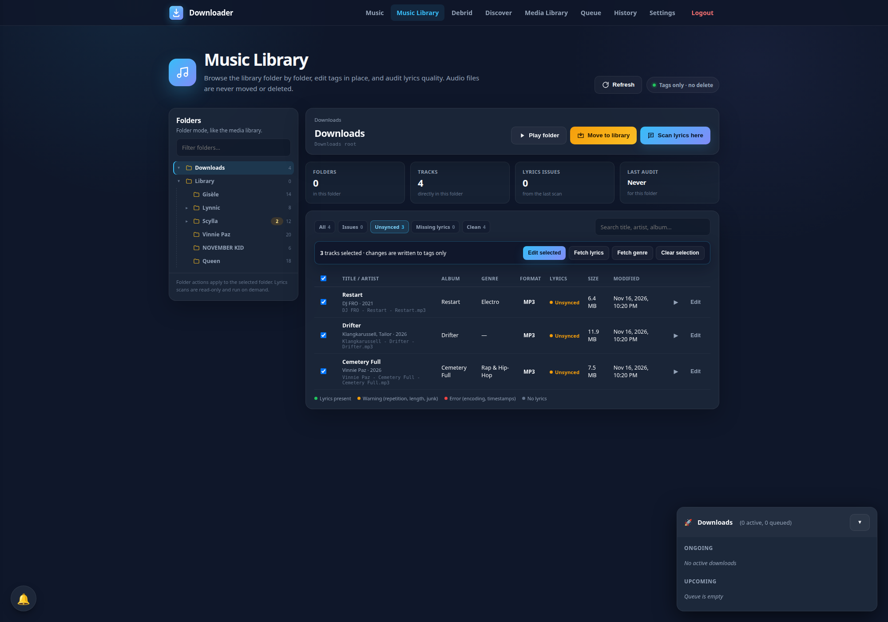
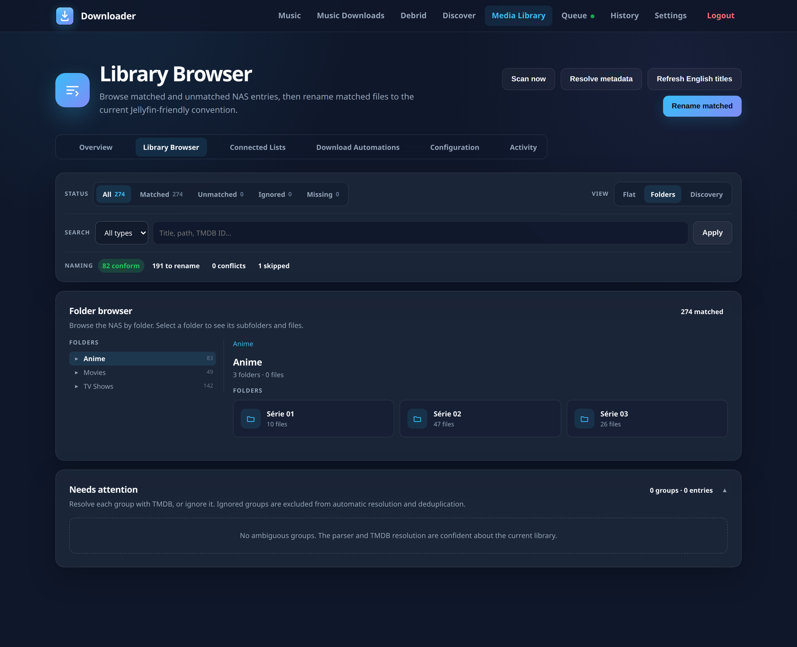
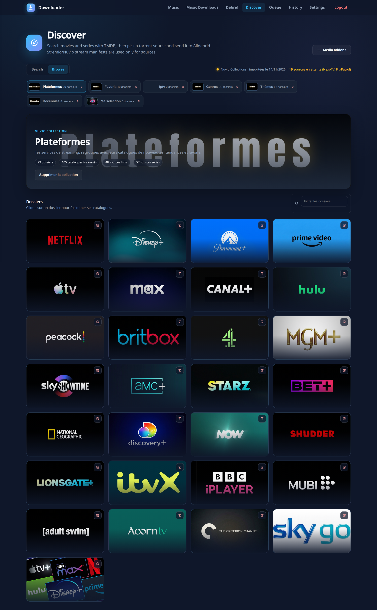
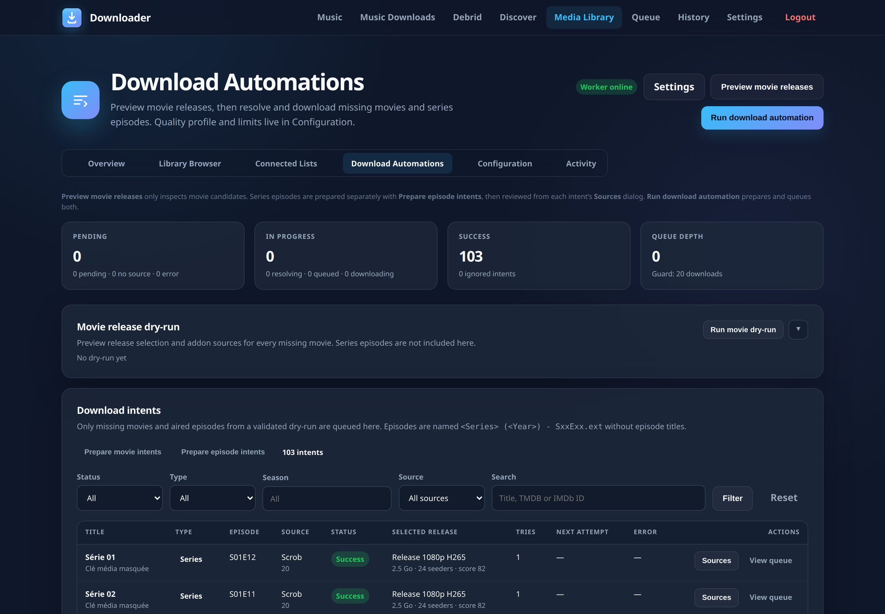

# Downloader

A self-hosted media management platform built with Symfony & Python and shipped as a single Docker image. It handles video, torrent and direct-link downloads through Alldebrid, a complete music pipeline from Spotify search to a tagged library, a TMDB/Stremio discovery interface, and an automation engine that keeps your NAS library in sync with external lists.

**Version:** 2.8.1

| Resource | Link |
| -------- | ---- |
| Application source | https://github.com/Gautardos/downloader |
| Containerized deployment (Docker Compose) | https://github.com/Gautardos/docker-downloader |
| Docker image | `gautardos/downloader-app` |

---

## ✨ Features

### 🎬 Videos, Torrents & Direct Links
- **Magnet & `.torrent` upload** with Alldebrid cloud debridding.
- **Torrent search** backed by a local SQLite database (`hash-db`), with title search, categories and magnet auto-fill.
- **Magnet preview** — inspect file list, sizes and Alldebrid status before committing.
- **Pack grouping** — automatic detection of series/albums with recursive folder creation.
- **Batch folder creation** — one-click creation of all missing directories during bulk import.
- **Direct links** — send a list of HTTP links to the download queue.
- **AI-assisted renaming** — clean, normalized file names suggested by your configured AI model (the ✨ button is hidden when no AI key is configured).
- **Recent downloads** — paginated Alldebrid history with cached responses.

### 🔎 Discover (TMDB + Addons)
- **TMDB search** for movies and series, with details, seasons and episodes.
- **Stremio/Nuvio addons** used as stream sources (public HTTPS manifests only).
- **Nuvio collections import** with catalog/dossier mapping and per-addon activation.
- **One-click debrid** — pick a source and send the torrent to Alldebrid and the queue.
- **TMDB artwork and metadata** exposed to the Jellyfin bridge.

### 🎵 Music
- **Spotify search** for tracks, albums and playlists, including private playlists through the librespot token.
- **High-quality downloads** powered by Zotify. **Auto** (default) uses the best quality your Spotify account allows: **320 kbps on Premium**, **160 kbps on Free**. 320 kbps requires Premium.
- **Unified Music Library** — browse `Downloads` (`music_root_path`) and `Library` (`music_library_path`) roots in a single folder tree.
- **Full tag editor** — title, artist, album, album artist, year, genre, track/disc numbers, comment and embedded lyrics, single or bulk.
- **Lyrics** — LRCLIB (synced + scored search), Genius and lyrics.ovh fallback, per-track or batch fetch.
- **Lyrics audit** — read-only folder-level detection for encoding, timestamps, junk, repetition, abnormal length and missing lyrics.
- **AI genre classification** — configurable model and prompt, plus regex mapping.
- **Library automation** — move, rename and organize files into `Artist/Artist - Album - Track - Title.ext`.
- **Simple audio player** — play a track or the current folder with seek, volume and queue controls.
- **Spotify authentication** — generate credentials from Settings with the built-in `librespot-auth` binary.

### 🤖 Automations (NAS library)
- **Library index** for Movies, TV Shows and Anime roots, with incremental scans and NFO support.
- **Library Browser** — Flat, Folders and Discovery views with TMDB metadata, posters and naming status.
- **Metadata resolution** — match ambiguous entries to TMDB, fix matches manually or ignore groups.
- **Jellyfin renaming** — preview and apply `Title (Year)` / `SxxExx` naming, with sidecar handling and undo.
- **Connected Lists** — import Scrob and MDBList lists, dry-run matching against the NAS, and ignore items.
- **Quality profile** — resolution, codecs, HDR, audio languages, seeders, size limits and addon priority.
- **Automatic downloads** — create intents for missing movies and episodes, resolve releases, send to Alldebrid and track download status.
- **Series numbering** — align TMDB episodes with TVDB/Cinemeta/TVmaze/AIOMetadata numbering.
- **Dry-run** — preview release selection without contacting Alldebrid or queueing anything.
- **Activity** — scan, resolution, list and intent history.
- **In-app help** — a complete guide is available at `/automation/help`.

### 📺 Jellyfin / Nuvio
- **Jellyfin-compatible API** under `/jellyfin`, read-only and direct-play only.
- **Nuvio integration** — add `http://<host>:8000/jellyfin` as a Jellyfin server (the root URL also redirects discovery).
- **Resume state, played status, search, TMDB artwork and external subtitles.**

### 🛠️ System
- **Download queue** — sequential processing via a background worker (Supervisor-managed).
- **Automation worker** — scans, list syncs and release intents in the background.
- **Maintenance worker** — scheduled torrent DB update, log rotation and optional integrity scans.
- **Music automations worker** — follows Spotify playlists and queues missing tracks.
- **Global search** — one palette (`Ctrl/Cmd+K`) across actions, torrents, history, TMDB and Spotify.
- **Statistics** — activity dashboard with `7d` / `30d` / `90d` / all periods and CSV export.
- **Video integrity** — detects truncated, corrupt or missing downloads and can requeue them.
- **PWA & Web Push** — installable app, offline status page, VAPID push notifications for downloads, errors, automations and integrity.
- **Real-time tracker** — live progress with polling and browser notifications.
- **Full history** — detailed action logs with a configurable retention limit.
- **Authentication** — simple login with configurable credentials (default: `admin` / `admin`) and CSRF protection.
- **AI provider** — OpenRouter (default) with xAI fallback and a model per usage (default, renaming, music genre).
- **Adaptive UI** — navigation items are hidden automatically when their dependencies are not configured.
- **File-based storage** — JSON for configuration/queue/history, SQLite for torrents, automations, maintenance, integrity, music rules and PWA subscriptions; no external SQL server required.

---

## 📸 Screenshots

| Music Library | Automations — Library Browser |
| ------------- | ----------------------------- |
|  |  |

| Discover | Automations — Downloads |
| -------- | ----------------------- |
|  |  |

---

## 🐳 Installation (Docker)

The application is distributed as a pre-built Docker image. The recommended way to deploy it is the dedicated Compose repository: **https://github.com/Gautardos/docker-downloader**.

### Prerequisites

- **Docker** and **Docker Compose v2** on a Linux host (or Docker Desktop on Windows/macOS).
- An **Alldebrid** account for video/torrent features.
- A **Spotify** developer account and a Spotify session for music features.
- Optional: a **TMDB** API key (Discover), an **OpenRouter** or **xAI** key (AI features), **Scrob/MDBList** credentials (Automations), a **Jellyfin/Nuvio** client (streaming).
- **HTTPS** (or `localhost`) for the PWA: installing the app, the service worker and Web Push require a secure context. Plain HTTP on a LAN IP will not enable them.

> [!IMPORTANT]
> The Compose file uses `network_mode: host`. On Docker Desktop for Windows this requires **Docker Desktop ≥ 4.34** with Linux containers (see the Windows section of the [container repository](https://github.com/Gautardos/docker-downloader)).

### 1. Get the Compose files

```bash
git clone https://github.com/Gautardos/docker-downloader.git ~/downloader-app
cd ~/downloader-app
cp .env.example .env
```

### 2. Create the data directories

```bash
mkdir -p var/{db,home,storage}
mkdir -p downloads music nas
sudo chown -R 1000:1000 var downloads music nas
```

- `var/db/` — SQLite databases (torrent search, automation index, maintenance, integrity, music automations, PWA push subscriptions).
- `var/home/` — persistent home (Spotify credentials, Zotify archive).
- `var/storage/` — configuration, queue, history, logs, caches and the VAPID key pair.
- `downloads/`, `music/`, `nas/` — media mounts. Adapt them to your disks or NFS/SMB shares.

The application processes run as UID 1000 inside the container: data and media directories must be writable by that UID (on network shares, by the UID the share maps writes to).

### 3. Configure `.env`

```env
IMAGE_TAG=latest
PORT=8000
DATA_DIR=./var
DOWNLOADS_DIR=./downloads
MUSIC_DIR=./music
NAS_DIR=./nas
```

Use an explicit version (for example `IMAGE_TAG=2.8.1`) if you want reproducible deployments. Paths are **host** paths; they are mounted to fixed container paths.

> [!NOTE]
> The image serves HTTP on port **8000**. Keep `PORT=8000` unless you customize the image; with `network_mode: host`, the application is reachable on that port.

### 4. Create the application secret

Secrets must never be stored in the Compose file or in `.env`. Create this file before the first start: if it is missing, Docker creates a directory with that name instead. Create `var/.env.local`:

```bash
printf 'APP_ENV=prod\nAPP_DEBUG=0\nAPP_SECRET=%s\n' "$(openssl rand -hex 32)" > var/.env.local
chmod 600 var/.env.local
```

This file is mounted read-only at `/var/www/html/.env.local`. The file must be owned by UID 1000.

### 5. Start the container

```bash
cd ~/downloader-app
docker compose up -d
```

The application is then available at **`http://<your-ip>:8000`**.

<details>
<summary>Compose reference (already included in the container repository)</summary>

```yaml
services:
  downloader:
    image: gautardos/downloader-app:${IMAGE_TAG:-latest}
    container_name: downloader-container
    network_mode: host
    environment:
      - PORT=${PORT:-8000}
    volumes:
      - ${DATA_DIR:-./var}/.env.local:/var/www/html/.env.local:ro
      - ${DATA_DIR:-./var}/db:/var/www/html/var/db
      - ${DATA_DIR:-./var}/home:/var/www/html/var/home
      - ${DATA_DIR:-./var}/storage:/var/www/html/var/storage
      - ${DOWNLOADS_DIR:-./downloads}:/downloads
      - ${MUSIC_DIR:-./music}:/music
      - ${NAS_DIR:-./nas}:/nas
    restart: unless-stopped
    logging:
      driver: "json-file"
      options:
        max-size: "10m"
        max-file: "3"
```

</details>

### 6. First login

Open the application in your browser. Default credentials:

| Field    | Value   |
| -------- | ------- |
| Username | `admin` |
| Password | `admin` |

> [!TIP]
> Change these before exposing the application outside your LAN (it listens on all interfaces with network_mode: host). Put it behind a reverse proxy with HTTPS for remote access.

### Windows

The container repository contains a dedicated Windows guide (Docker Desktop version requirements, host networking, PowerShell paths and volume syntax). In short:

1. Create the data directories (`var\db`, `var\home`, `var\storage`) under `%USERPROFILE%\downloader-app`.
2. Copy `.env.example` to `.env` and adapt drive paths (for example `D:\downloads`).
3. Start with `docker compose up -d` from PowerShell.

With host networking disabled, replace `network_mode: host` with `ports: ["8000:8000"]`.

### Update

```bash
cd ~/downloader-app
docker compose pull
docker compose up -d
```

To pin a version, set `IMAGE_TAG=<version>` in `.env` before pulling. No manual migration is required between 2.x versions; coming from 1.x, see Upgrading from 1.x. Existing storage paths keep working.

To roll back, set the previous `IMAGE_TAG` and run the same commands.

> [!NOTE]
> With the legacy docker-compose v1, run `docker-compose down` before `docker-compose up -d` after a pull.

### Upgrading from 1.x

Use the Compose file from docker-downloader; stop mounting `src/` and `templates/` (the code is in the image); create `var/.env.local` (see above); give existing data to UID 1000 (`sudo chown -R 1000:1000 <DATA_DIR>`).

---

## ⚙️ Configuration

Settings are managed through the web UI at **Settings** (`/config`), except TMDB/addons (Discover drawer) and Automations (dedicated **Automations → Configuration** page). See [`.env` / `.env.local`](#4-create-the-application-secret) for runtime secrets.

### 🔑 API Keys & AI

| Setting | Purpose | Required for |
| ------- | ------- | ------------ |
| **Alldebrid API Key** | Debridding and downloading torrents/magnets | Videos, Torrents, Discover |
| **AI Provider** | `openrouter` (default) or `xai` | AI features (optional) |
| **OpenRouter API Key** | AI renaming, genre detection and other AI usages | AI features (optional) |
| **Default / Renaming / Music genre model** | Model per usage, chosen from the OpenRouter catalog | AI features |
| **xAI API Key** | Fallback provider when no OpenRouter key is set | AI features (optional) |
| **Spotify Client ID / Secret** | Spotify Web API metadata search | Music search |
| **Genius API Token** | Plain-text lyrics | Lyrics (optional) |
| **LRCLib Token** | Synced LRC lyrics | Lyrics (optional) |
| **TMDB API Key** | Search, metadata and artwork | Discover, Jellyfin metadata (configured in the Discover drawer) |

> [!NOTE]
> The AI provider is resolved per usage: a usage-specific model, then the default model, then the xAI fallback. Without any AI key, AI buttons are hidden.

### 📂 Paths

| Setting | Default (Docker) | Description |
| ------- | ---------------- | ----------- |
| **Default Torrent Download Path** | `/downloads` | Where torrent/video files are saved |
| **Music Download Root** | `/music` | Temporary download directory for music (`Downloads` root) |
| **Library Target Path** | *(empty)* | Final organized music library (`Library` root), e.g. `/nas/Music` |
| **JSON Credentials Path** | `/var/www/html/var/home/.local/credentials.json` | Spotify auth credentials file |
| **History Archive File** | `/var/www/html/var/home/log/archive.txt` | Already-downloaded track log |
| **Venv Path** | `/opt/venv` | Python virtual environment (pre-configured in Docker) |
| **Music Command Binary** | `zotify` | CLI tool for music downloads |
| **Librespot Auth Binary** | `/var/www/html/var/librespot-auth/target/release/librespot-auth` | Spotify auth generator |

> [!WARNING]
> All paths in Settings are **container-internal** paths. With `NAS_DIR=./nas` mounted at `/nas`, use `/nas/...` in Automations — never the host path.

### 🎵 Music

| Setting | Default | Description |
| ------- | ------- | ----------- |
| **Output Template** | `{artist} - {album} - {song_name}.{ext}` | File naming template |
| **Format** | `mp3` | Output format (`mp3`, `flac`, `m4a`, `opus`) |
| **Quality** | `auto` | `auto` = best allowed (320 Premium / 160 Free); `normal` = 96 kbps; `high` = 160 kbps; `very_high` = 320 kbps (Premium only) |
| **Skip Existing** | Off | Skip tracks already in the archive |
| **Download Lyrics** | On | Fetch and embed lyrics with Zotify |
| **Retry Attempts** | `3` | Network retries |
| **Genre Tagging Mode** | `AI` | `AI` (OpenRouter/xAI) or `Mapping` (regex) |
| **Use Spotify artist genres** | On | Use Spotify genres as a signal before AI |
| **Regex Genre Mapping** | — | JSON `{"genre_patterns": {"regex": "Genre"}}` |

### 🔐 Admin

| Setting | Default | Description |
| ------- | ------- | ----------- |
| **Admin User** | `admin` | Login username |
| **Admin Password** | `admin` | Login password |
| **History Retention** | `500` | Maximum number of entries kept in history |

### 🎬 Jellyfin / Nuvio

| Setting | Default | Description |
| ------- | ------- | ----------- |
| **Enable Jellyfin API** | Off | Exposes the Automation library under `/jellyfin` |
| **Server Name** | `Downloader` | Name shown in Nuvio |
| **Jellyfin Username** | `jellyfin` | Dedicated username for Nuvio |
| **Jellyfin Password** | *(empty)* | Dedicated password; login is disabled while empty |

In Nuvio, add a Jellyfin server with the address `http://<your-host>:8000/jellyfin` (or simply `http://<your-host>:8000`, which redirects the discovery endpoint) and the dedicated credentials. Run a library scan from Automations first if the index is empty.

### 🤖 Automations

Configured in **Automations → Configuration** (stored in `var/db/automation.db`, not `config.json`):

- **Library roots and scanner** — movies, TV shows and anime paths under `/nas`, scan interval, NFO parsing.
- **Quality profile** — resolution order, codecs, HDR, audio languages, minimum seeders, max movie/episode size, excluded tags, addon priority.
- **Limits and guardrails** — max intents per run, queue guard, retries/backoff.
- **Connected Lists** — Scrob and MDBList sources, credentials and list selection (page **Connected Lists**).
- **Metadata** — title language, TMDB lookups budget and cache.

The built-in guide at **Automations → Aide** (`/automation/help`) documents the full workflow.

---

## 🎵 Spotify Setup

The music features require two independent Spotify configurations.

### 1. Spotify API credentials (metadata search)

1. Go to the [Spotify Developer Dashboard](https://developer.spotify.com/dashboard).
2. Log in and click **Create app**.
3. Fill in a name (e.g. `My Downloader`) and a redirect URI (e.g. `http://localhost:8000/callback`).
4. Save, then open **Settings** on the app page.
5. Copy the **Client ID** and **Client Secret** into the application's Settings.

### 2. Spotify authentication (music downloads)

The download engine needs a valid Spotify session stored as a `credentials.json` file.

**Option A — From the UI (recommended):**

1. Go to **Settings**.
2. Click the **⚡ Auth** button next to **JSON Credentials Path**.
3. Open Spotify on your phone/desktop and select the device named `Speaker <timestamp>` as output (both devices must be on the same network).
4. The credentials file is generated, transformed and stored automatically.

> [!NOTE]
> The ⚡ Auth button only appears when no credentials file exists at the configured path.

**Option B — Manual (inside the container):**

```bash
docker exec -it downloader-container bash
export HOME='/var/www/html/var'
cd /var/www/html/var
/var/www/html/var/librespot-auth/target/release/librespot-auth --name "Speaker Manual"
# → Select "Speaker Manual" in Spotify
# → credentials.json is created in /var/www/html/var/
```

Then copy/transform the file to the expected path:

```bash
cp /var/www/html/var/credentials.json /var/www/html/var/home/.local/credentials.json
```

### 3. Audio quality and Spotify account type

Spotify enforces audio quality on its servers; the client cannot unlock more than your account allows.

| Account | Maximum quality | Recommended setting |
| ------- | --------------- | ------------------- |
| Free | 160 kbps | `auto` or `high` |
| Premium | 320 kbps | `auto` |

- **Auto** (default) selects 320 kbps on Premium and 160 kbps on Free.
- **Very High** (320 kbps) requires Premium. On a Free account it fails with `Audio key error` / `Failed fetching audio key`; the job is retried before failing.
- **Normal** = 96 kbps, **High** = 160 kbps, **Very High** = 320 kbps.
- The output format (MP3/FLAC/M4A/Opus) cannot increase the source quality: a lossy source stays lossy, and FLAC only makes the file larger.
- Use credentials from the same Spotify account you want to download with.

---

## 🔎 Discover Setup

1. Open **Discover** and click the settings/addons drawer.
2. Add a **TMDB API key** (or v4 read token) and choose the metadata language.
3. Add one or more **Stremio/Nuvio addon manifests** (public HTTPS URLs only).
4. Optionally import a **Nuvio collections** JSON export; sources are activated automatically when their addon is configured.
5. Search a movie/series, pick a source, then send it to Alldebrid.

---

## 🏗️ Architecture

The container runs six services managed by **Supervisor**:

| Service | Role |
| ------- | ---- |
| **Apache** | Serves the Symfony application on port 8000 |
| **Redis** | Stores PHP sessions (prevents session lock contention) |
| **Download Worker** | Sequentially processes the download queue (`app:download-worker`) |
| **Automation Worker** | Runs scheduled scans, list syncs and release intents (`app:automation-worker`) |
| **Maintenance Worker** | Runs the maintenance schedule (`app:maintenance --loop`) |
| **Music Automations Worker** | Follows Spotify playlists (`app:music-automations --loop`) |

All workers write their stderr to `var/storage/logs/*_error.log`. The
`maintenance.db`, `integrity.db`, `music_automations.db` and `pwa.db` SQLite
databases are created automatically in `var/db` on first use.

### Volume mapping explained

```
Host                                    → Container
────────────────────────────────────────────────────────────────
~/downloader-app/var/db                 → /var/www/html/var/db         (SQLite: torrents, automation, maintenance, integrity, music, PWA)
~/downloader-app/var/home               → /var/www/html/var/home       (Spotify creds, archive)
~/downloader-app/var/storage            → /var/www/html/var/storage    (config, queue, history, logs, VAPID keys)
~/downloader-app/downloads              → /downloads                   (torrent/video output)
~/downloader-app/music                  → /music                       (music downloads)
~/downloader-app/nas                    → /nas                         (NAS library, read/write)
```

> [!WARNING]
> Paths configured in Settings and Automations refer to **container-internal** paths. If you mount a host directory at `/music`, set **Music Download Root** to `/music` — not the host path.

---

## 🔧 How Alldebrid Works

The application is **not** a BitTorrent client. It delegates P2P downloads to the [Alldebrid](https://alldebrid.com) cloud service:

1. **Submit** — magnet link or `.torrent` file uploaded via the UI (Debrid or Discover).
2. **Cloud download** — Alldebrid fetches the content on its high-speed servers.
3. **Link extraction** — the API returns direct HTTP links for each file once ready.
4. **Debridding** — each link is unlocked for full-speed direct download.
5. **Local transfer** — the background worker downloads files to your local storage directory.

---

## 📂 Project Structure

```
src/                → Symfony controllers, services, commands and subscribers
templates/          → Twig views (UI)
cli/                → Python scripts (download engine, lyrics, tagging/rename/move, audit)
public/             → Web entry point and static assets
var/db/             → SQLite databases (torrent search, automation)
var/storage/        → JSON data (config, queue, history, caches, logs)
var/home/           → Persistent home (Spotify credentials, archive)
Dockerfile          → Container build definition
docker-entrypoint.sh→ Runtime permissions and startup
supervisord.conf    → Process manager configuration
```

### CLI Scripts

| Script | Purpose |
| ------ | ------- |
| `music_downloader.py` | Music download engine (wraps Zotify, verify/tags modes) |
| `lyrics_fetcher.py` | Fetches and embeds lyrics (LRCLIB/Genius/lyrics.ovh) |
| `lyrics_audit.py` | Read-only lyrics audit |
| `tag_rename_move.py` | Tags, renames and moves files to the organized library |
| `spotify_user.py` | Private playlists and metadata through the librespot token |

---

## 🔧 Maintenance

### View logs

```bash
# Apache
docker exec -it downloader-container cat /var/log/apache2_error.log

# Download worker
docker exec -it downloader-container cat /var/www/html/var/storage/logs/worker.log

# Automation worker
docker exec -it downloader-container cat /var/www/html/var/storage/logs/automation_worker.log

# Maintenance and music automations workers
docker exec -it downloader-container cat /var/www/html/var/storage/logs/maintenance_error.log
docker exec -it downloader-container cat /var/www/html/var/storage/logs/music_automations_worker_error.log

# Worker fatal errors
docker exec -it downloader-container cat /var/www/html/var/storage/logs/worker_error.log
docker exec -it downloader-container cat /var/www/html/var/storage/logs/automation_worker_error.log

# Supervisor
docker exec -it downloader-container supervisorctl status
docker exec -it downloader-container cat /var/log/supervisord.log
```

Application logs live in `var/storage/logs/` and rotate at **5 MB per file with 5 backups** (`*.log.1` … `*.log.5`).

### Restart services

```bash
# Restart the whole container
docker compose restart

# Restart only the download worker
docker exec -it downloader-container supervisorctl restart worker

# Restart only the automation worker
docker exec -it downloader-container supervisorctl restart automation-worker

# Restart the maintenance or music automations worker
docker exec -it downloader-container supervisorctl restart maintenance-worker
docker exec -it downloader-container supervisorctl restart music-automations-worker
```

### Backup & restore

Back up these directories (they contain all state):

- `var/storage/` — configuration, queue, history, caches.
- `var/db/` — torrent search and automation databases.
- `var/home/` — Spotify credentials and Zotify archive.
- `var/.env.local` — application secret.

The **Settings → Backup & Restore** panel can export/import the configuration as a ZIP (`config.json` + credentials).

### Update

```bash
docker compose pull
docker compose up -d
```

---

## 📝 Notes & Limits

- Configuration, queue and history use JSON files (`JsonStorage`) under `var/storage/`; SQLite is used for the torrent search database, automation index, maintenance/integrity runs, music automation rules and PWA push subscriptions. Redis is used **only** for PHP sessions.
- **PWA / Web Push** require a secure context (HTTPS or `localhost`). VAPID keys are generated on first start in `var/storage/pwa_vapid.json` (mode `0600`); the private key never leaves the server. Push endpoints are restricted to the official FCM/Mozilla/Apple/Microsoft hosts.
- The `librespot-auth` binary is compiled during the image build and does not need to be installed separately.
- Automations never delete NAS files: missing files are marked `missing`, and only explicit actions (rename, prune empty folders) move things.
- The Jellyfin bridge is **direct play only** (no transcoding) and exposes video only.
- Spotify audio quality is account-bound: Free accounts are capped at 160 kbps; 320 kbps requires Premium. Use **Auto** to avoid `Audio key error` on Free accounts.
- Lyrics fetching supports MP3 and M4A; the audit is read-only and synchronous.
- Paths configured in the UI are container-internal. Keep the host mount layout stable across upgrades.
- At startup the entrypoint enforces permissions on its data: `var/storage` 710, `var/storage/logs` 2750 (setgid), `*.log` 640, other files 600, `var/db` 700/600. To let an external log shipper read the logs, give `var/storage` and `var/storage/logs` a group it belongs to. Mounted media folders are never changed recursively: only their top level is adjusted when owned by root, and a refused change (network share) does not block startup.
- If the host already runs Redis on `127.0.0.1:6379` (host networking), the application uses it for sessions instead of the bundled one.
- 2.8.1 upgrades the runtime to Symfony **6.4 LTS** (PHP 8.1+), Twig 3.30 and Guzzle 7.16/PSR-7 2.13. `composer audit` reports **0 advisories**.

---

## 🔗 Related Repositories

- **Application:** https://github.com/Gautardos/downloader
- **Containerized deployment (Compose, Windows guide, release compose):** https://github.com/Gautardos/docker-downloader
- **Release notes:** [RELEASE_NOTES_2.6.md](RELEASE_NOTES_2.6.md) · [RELEASE_NOTES_2.7.md](RELEASE_NOTES_2.7.md) · [RELEASE_NOTES_2.7.1.md](RELEASE_NOTES_2.7.1.md) · [RELEASE_NOTES_2.7.2.md](RELEASE_NOTES_2.7.2.md) · [RELEASE_NOTES_2.8.3.md](RELEASE_NOTES_2.8.3.md)
