# Downloader 2.6 — Automations

> Votre bibliothèque ne se contente plus de télécharger. Elle veille, compare, décide, range — et vous gardez le dernier mot.

La 2.6 est la mise à jour la plus ambitieuse depuis longtemps. Elle transforme Downloader en un véritable chef d'orchestre de votre médiathèque : vos listes externes deviennent une file d'attente intelligente, votre NAS devient un index interrogeable, et les films **comme les épisodes de séries** manquants peuvent être récupérés automatiquement dans la qualité que vous avez définie.

Bienvenue dans **Automations**.

## 2.6.2 — Correctifs Library

- **Rename matched** met désormais à jour le `folder_path` réel : le Folder
  Browser ne conserve plus l'ancien nom de dossier après un déplacement.
- Un scan répare aussi les `folder_path` obsolètes, même lorsque le fichier
  n'a pas changé de taille ou de date.
- **Refresh titles** rafraîchit maintenant les films **et les séries**. Pour
  les séries, le dossier logique (`show_folder`) est aligné sur
  `Titre (Année)` avant le renommage.
- Nouveau bouton **Clean empty folders** et commande
  `app:library-prune-empty-dirs [--root=movies] [--dry-run]` pour supprimer
  les dossiers vides laissés par les renommages.
- Les dossiers non vides, les racines et les dossiers cachés sont préservés.

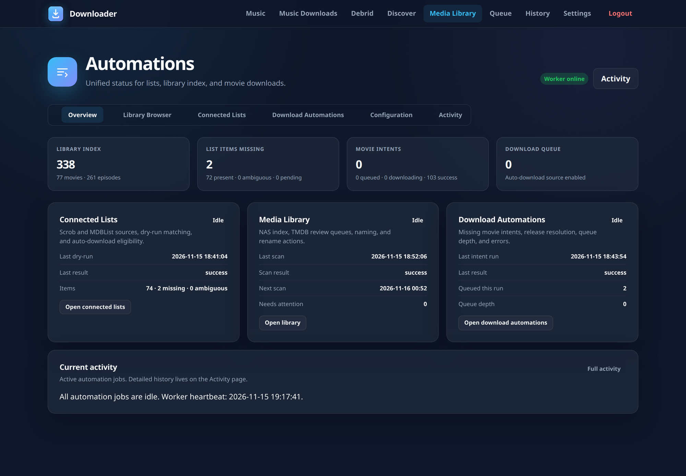

## Le concept

Jusqu'ici, Downloader excellait à télécharger ce qu'on lui demandait. Avec la 2.6, il commence à comprendre **ce qui manque** et **ce qu'il faut faire**.

Le pipeline est simple à expliquer, puissant en pratique :

1. **Vos listes** — Scrob et MDBList sont lues, fusionnées et normalisées.
2. **Votre bibliothèque** — le NAS est scanné, les fichiers sont parsés film par film, série par série, épisode par épisode, avec détection de la numérotation d'acquisition.
3. **Le matching** — chaque élément de liste est confronté à l'index réel, avec résolution TMDB et IMDb. Les épisodes déjà diffusés sont comptés, les épisodes futurs et les spéciaux sont gérés séparément.
4. **Le dry-run** — vous voyez exactement ce qui est présent, manquant, ambigu ou ignoré. Rien n'est téléchargé à ce stade.
5. **La décision** — **Preview movie releases** inspecte les candidats films sans rien modifier. **Prepare episode intents** prépare les épisodes manquants. **Run download automation** prépare puis résout et met en file les releases qui passent votre profil qualité, avec un score et une explication. Chaque intent peut aussi être revu via **Sources**.
6. **Le téléchargement et la vérification** — les fichiers sont contrôlés (taille, contenu, complétude), les téléchargements invalides sont écartés et remis en attente plutôt que marqués comme réussis.
7. **Le rangement et la lecture** — les fichiers arrivent directement dans la convention Jellyfin, prêts à être lus par la passerelle intégrée.

C'est un cercle complet : **liste → index → matching → décision → téléchargement → vérification → renommage → lecture**. Et à chaque étape, vous pouvez inspecter, corriger, ignorer ou prévisualiser.

## Les nouveaux écrans

### 1. Overview — le cockpit

Un seul écran pour savoir si tout va bien : état du worker, heartbeat, alertes, nombre de films et d'épisodes indexés, éléments de listes manquants, intents en cours et profondeur de file. Les trois cartes Connected Lists / Media Library / Download Automations résument la dernière activité et permettent de sauter directement au bon endroit.

### 2. Connected Lists — les sources, sans surprise

Configurez une ou plusieurs sources Scrob et MDBList, testez la connexion, sélectionnez plusieurs listes par source et lancez un dry-run avec **Dry-run all sources**. Les cartes de sources se replient, affichent leur état Connected / Not configured et le nombre de listes actives. Le résultat est immédiatement lisible : **présent**, **manquant**, **ambigu**, **ignoré**. Les séries sont analysées au niveau des épisodes déjà diffusés, avec exclusion des épisodes futurs et gestion des spéciaux.

Deux automatisations indépendantes peuvent être activées par source : **Auto download missing movies** et **Auto download series episodes**. Tant qu'elles sont désactivées, le dry-run reste un pur outil d'analyse.

Le bouton **Queue missing episodes** crée les intents d'épisodes sans rien résoudre ni télécharger. Pour les séries, la colonne **Numbering** affiche la source de numérotation, la confiance et les segments détectés. Les actions **Detect numbering** / **Re-detect** et **Confirm mapping** permettent de valider un découpage ambigu avant de l'utiliser. Le mode **Jellyfin Local / TMDB** choisit la numérotation exposée par la passerelle, sans déplacer les fichiers.

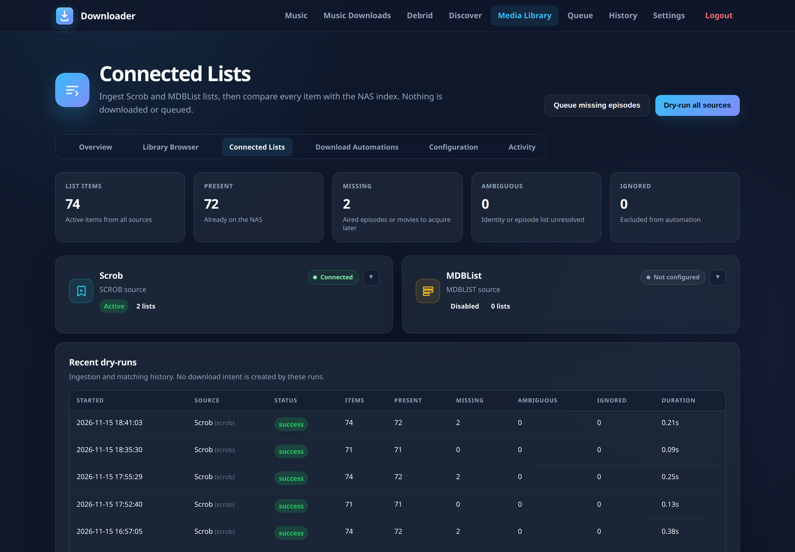

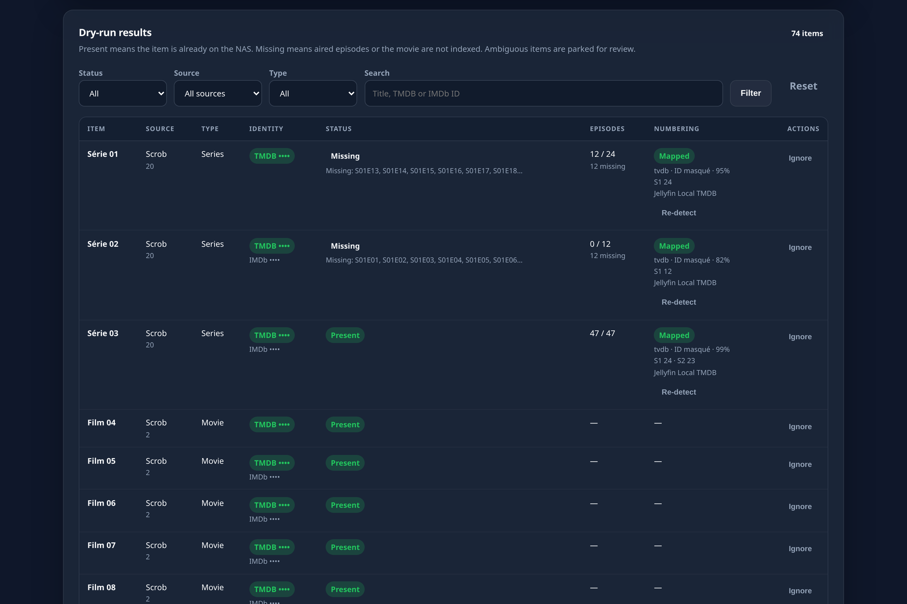

### 3. Library Browser — votre NAS, enfin lisible

Le point d'entrée **Media Library** de la navigation principale ouvre désormais le **Library Browser**. L'index est navigable de trois façons : **Flat** pour la liste complète, **Folders** pour retrouver l'arborescence réelle du NAS, et **Discovery** pour une grille visuelle enrichie par TMDB. Chaque élément affiche son identité, son taux de confiance, son état de nommage et ses fichiers.

La file **Needs attention** remonte les groupes ambigus : vous pouvez chercher le bon film ou la bonne série sur TMDB, appliquer un **Fix match** manuel, ou ignorer le groupe pour l'exclure de la résolution et de la déduplication.

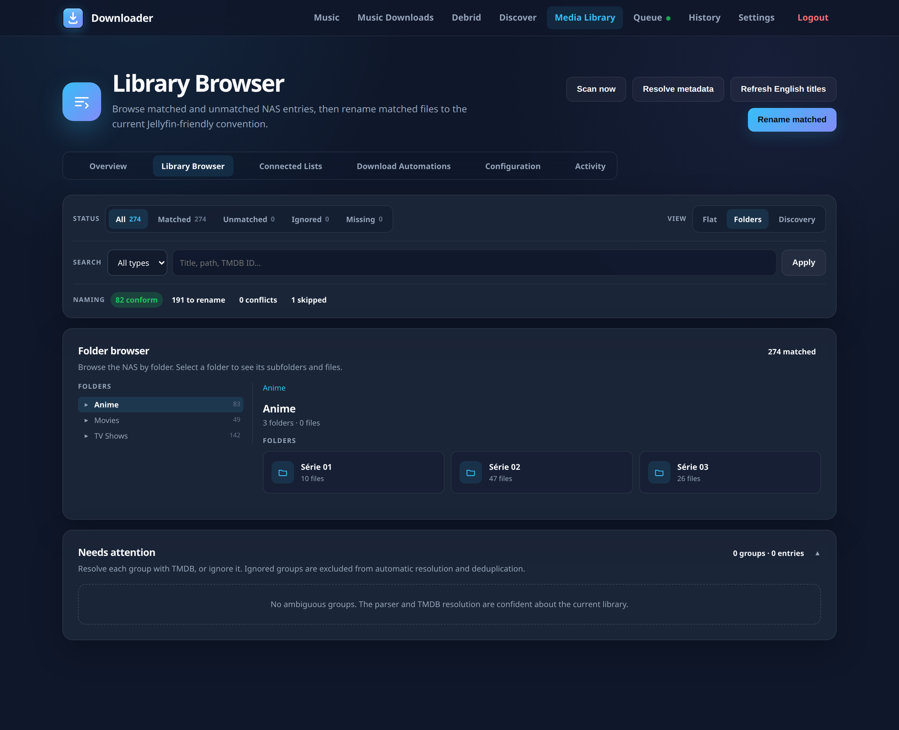

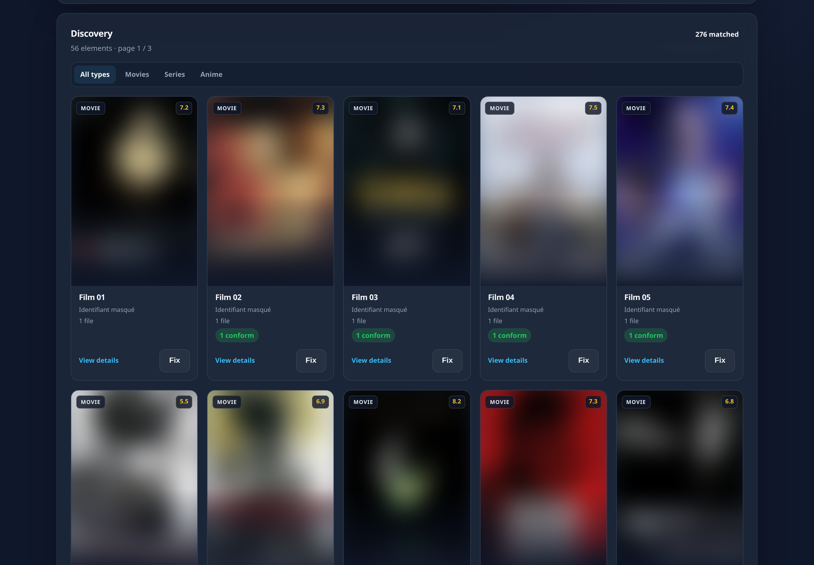

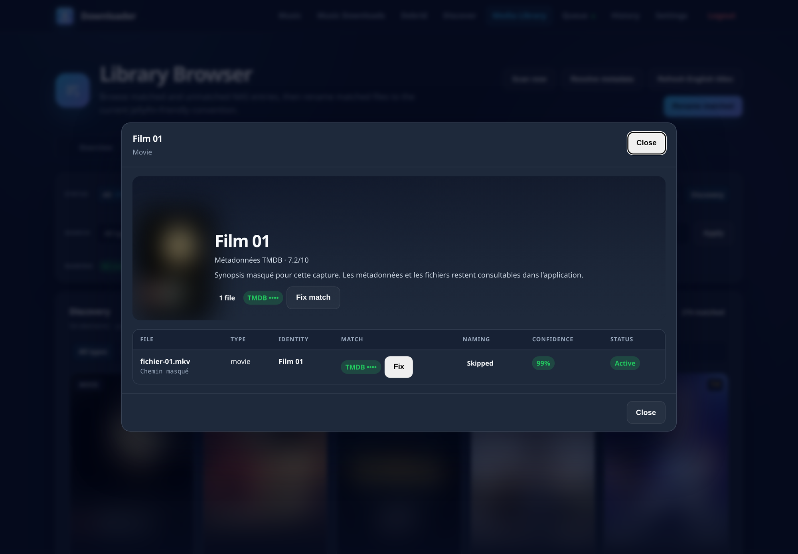

Les titres peuvent être rafraîchis dans la langue configurée — anglais par défaut — avec **Refresh English titles**, puis renommés en masse vers la convention Jellyfin. Le renommage est toujours précédé d'un **preview complet** : fichier source, cible, statut, conflits, fichiers ignorés. Rien n'est déplacé avant validation. Les runs de renommage disposent aussi d'un **undo** en CLI, et les entrées dont le fichier a disparu peuvent être marquées **missing** ou purgées sans toucher aux fichiers du NAS.

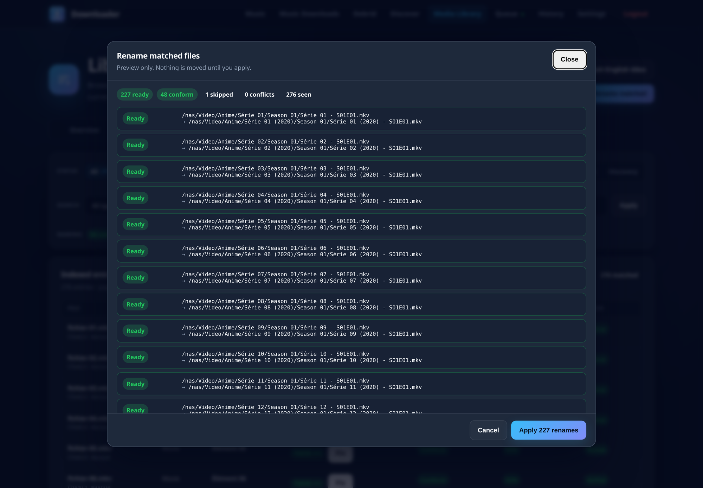

### 4. Download Automations — la qualité, pas le hasard

Chaque film ou épisode manquant devient un **intent** avec un statut clair : pending, resolving, queued, downloading, success, error, no_source, ignored. Les intents films et séries sont filtrés par type, saison, source et recherche. Les actions sont volontairement séparées : **Preview movie releases** inspecte les candidats films sans rien modifier, **Prepare episode intents** prépare les épisodes manquants, **Prepare movie intents** prépare les films, et **Run download automation** résout puis met en file les deux types selon les automatisations activées.

Le **profil qualité** est un vrai contrat : résolution min/max et ordre de préférence, codecs autorisés, HDR, langues audio, seeders minimum, taille maximale par film et par épisode, tags exclus, priorité des addons. Les filtres durs refusent ce qui ne correspond pas. Le score pondéré explique ensuite pourquoi une release est acceptée ou rejetée.

Chaque intent expose un bouton **Sources** : la fiche TMDB, les streams des addons et le détail des candidats acceptés ou filtrés. Vous pouvez choisir manuellement une autre source et la mettre en file. Ce choix est volontairement explicite : il contourne les filtres du profil qualité et doit rester un geste de dernier recours.

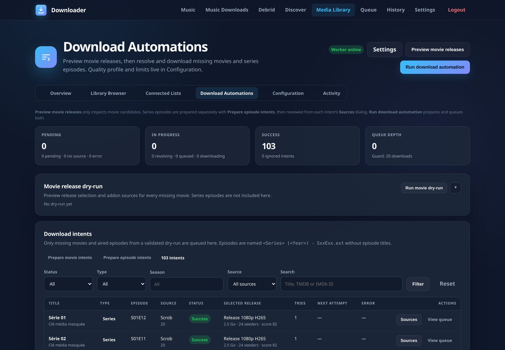

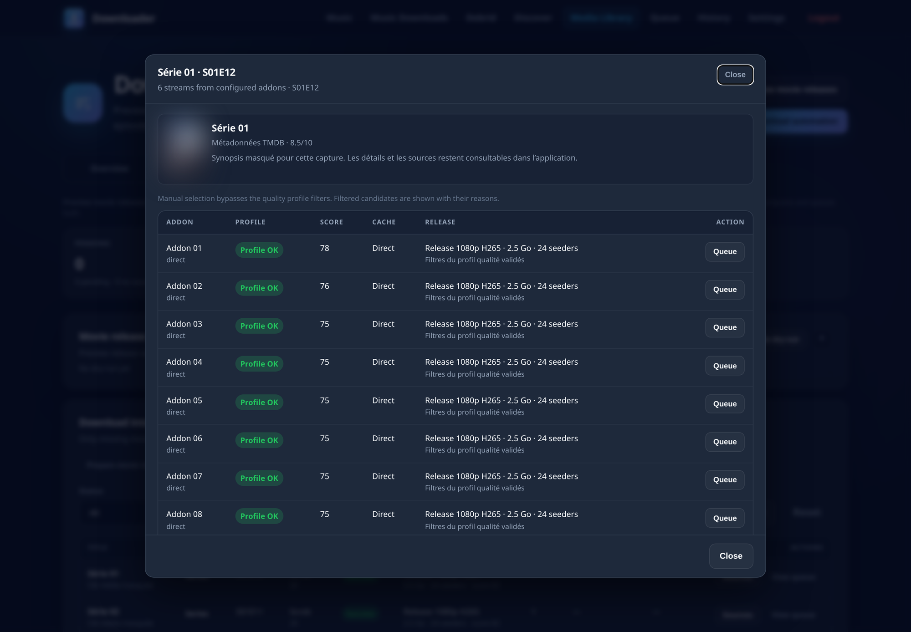

Pour les séries, Downloader refuse les packs de saison téléchargés en bloc et les multi-épisodes ambigus. Il sélectionne uniquement le fichier qui correspond exactement à l'épisode demandé. Les noms de fichiers suivent strictement `<Série> (<Année>) - SxxExx.ext`, sans titre d'épisode, avec la numérotation d'acquisition ou TMDB selon votre choix.

La sécurité est intégrée : **queue guard**, plafond d'intents par run, retries avec backoff, déduplication par TMDB/IMDb/titre/année/saison/épisode, réconciliation avec les listes, récupération des intents bloqués et vérification de ce qui est déjà dans la file ou déjà en cours. Pas de doublon silencieux.

### 5. Configuration — tout au même endroit

Racines NAS, extensions vidéo, taille minimale, intervalle de scan, options du scanner, profil qualité, limites de traitement, nombre maximal d'intents par run et langue des titres. Les chemins par défaut correspondent aux montages Compose standards.

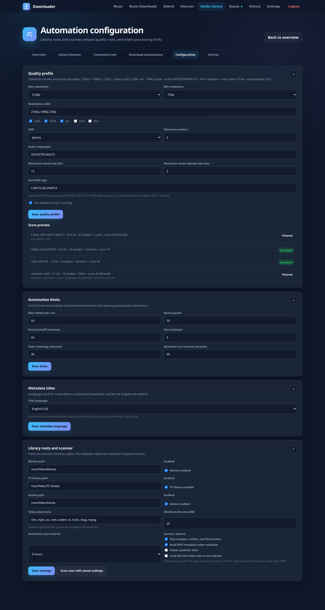

### 6. Activity — la transparence totale

Scans, résolutions de métadonnées, dry-runs de listes, runs d'intents, détection de numérotation et renommages : tout est historisé avec durée, compteurs et résultat. L'écran affiche aussi le heartbeat du worker, le prochain scan et une barre de progression quand une tâche tourne. Un point animé signale l'activité en cours directement dans les onglets.

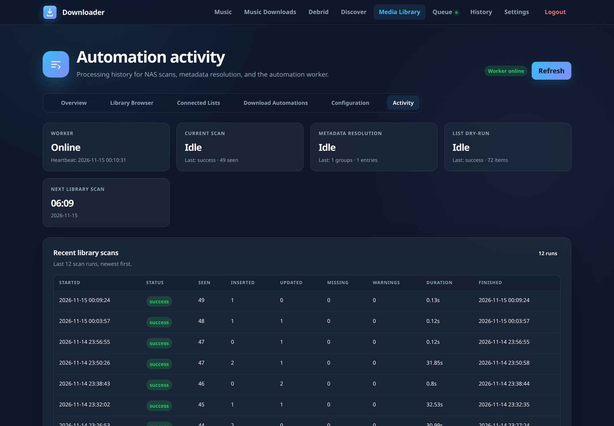

### 7. Jellyfin / Nuvio — la bibliothèque devient un serveur

Nouveauté majeure : Downloader expose un sous-ensemble en lecture seule de l'API Jellyfin. Activez la passerelle dans **Settings**, définissez un compte dédié, puis ajoutez `http://votre-hote:8000/jellyfin` comme serveur Jellyfin dans Nuvio. La bibliothèque indexée apparaît avec ses films, séries, épisodes, affiches, reprise de lecture et progression.

La passerelle peut exposer la numérotation **locale** (celle des fichiers) ou **TMDB**, sans déplacer les fichiers. La lecture se fait en **direct play** avec support des requêtes HTTP Range et des sous-titres externes. Aucun transcodage, aucun serveur supplémentaire.

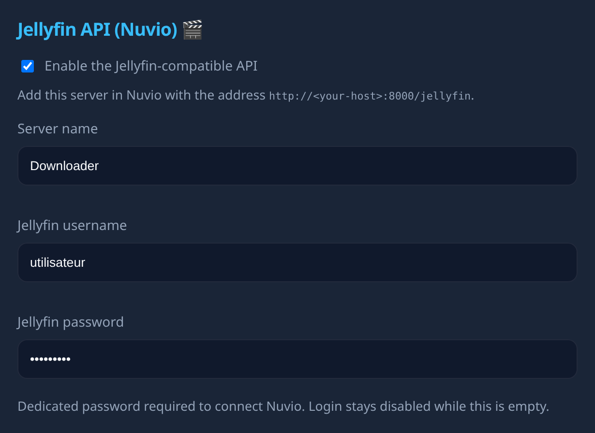

## Ce que ça change au quotidien

- **Vous ne cherchez plus ce qui manque.** Une liste se met à jour, un dry-run compare, et l'écart apparaît noir sur blanc.
- **Les séries sont enfin automatisées.** Les épisodes manquants peuvent être préparés puis téléchargés par lots, sans jamais prendre un pack de saison au hasard.
- **Vous gardez le dernier mot.** Dry-run, preview de renommage, profils qualité, boutons Ignore, Fix match, Sources : l'automatisation propose, vous décidez.
- **Vos fichiers arrivent déjà bien nommés.** Les téléchargements automation écrivent directement dans la convention Jellyfin, avec la bonne numérotation de saison et d'épisode.
- **Nuvio lit votre bibliothèque.** Plus besoin de maintenir un Jellyfin séparé pour profiter de l'intégration native de Nuvio.
- **Les erreurs ne passent plus inaperçues.** Les téléchargements invalides sont détectés, isolés et remis en attente au lieu d'être comptés comme réussis.

## Sécurité et fiabilité

La 2.6 durcit aussi les fondations :

- **CSRF global** sur les routes qui modifient l'état, avec jetons injectés dans les formulaires et les appels AJAX.
- **Protection SSRF** sur les URLs d'addons et les redirections.
- **Identifiants hachés**, expiration de session par inactivité, permissions resserrées et journaux nettoyés des secrets.
- **Rendu DOM sûr** pour la file et les notifications, polling authentifié et notifications en lecture seule.
- **Intégrité des téléchargements** : rejet des pages HTML, fichiers trop petits, contenus incomplets ou tailles incohérentes. Les fichiers invalides peuvent être mis en quarantaine (renommés `.invalid-<date>`) et l'intent repasse en attente.
- **Sélection déterministe** du fichier dans un torrent, avec refus des packs sans correspondance exacte et des multi-épisodes.
- **Maintenance des intents** : réconciliation avec les listes, récupération des intents bloqués, réactivation des succès orphelins et plafond par run.
- **Numérotation des séries** : providers AIOMetadata, Cinemeta et TVmaze, cache, détection des découpages multi-saisons et confirmation manuelle des mappings à faible confiance.

## Sous le capot

Automations repose sur une base SQLite dédiée en mode WAL, avec des verrous par tâche, un worker supervisé et des retries sur les accès concurrents. Les réglages sont séparés de la configuration historique. Les adaptateurs réutilisent le pipeline Discover/Alldebrid existant, avec cache TMDB, notifications groupées et journalisation détaillée.

Pour les utilisateurs avancés, tout est pilotable en CLI :

```bash
app:library-scan
app:library-resolve
app:library-title-refresh
app:library-reconcile-missing
app:library-rename-undo
app:series-numbering
app:automation-worker
app:lists-sync
app:release-dry-run
app:release-intents
app:release-intents-reconcile
app:release-verify-downloads
```

Les suites couvrent notamment `automation_smoke.php`, `backfill_smoke.php`, `jellyfin_smoke.php`, `auth_security_smoke.php`, `csrf_smoke.php`, `ssrf_smoke.php`, `session_secrets_smoke.php` et `functional_flow_smoke.php`.

## Pour démarrer

1. Mettez à jour l'image et redémarrez la stack.
2. Vérifiez vos racines NAS dans **Automations > Configuration**.
3. Ajoutez votre source Scrob ou MDBList dans **Connected Lists**, testez la connexion et sélectionnez vos listes.
4. Lancez un **dry-run** et parcourez les résultats.
5. Corrigez les éventuels groupes ambigus dans **Library Browser > Needs attention**.
6. Pour les séries, vérifiez la colonne **Numbering** : **Detect numbering**, puis **Confirm mapping** si nécessaire.
7. Prévoyez le renommage Jellyfin avec **Rename matched**, puis appliquez.
8. Si vous le souhaitez, activez **Auto download missing movies**, cliquez sur **Preview movie releases** pour vérifier les candidats, puis lancez **Run download automation**.
9. Pour les séries, activez **Auto download series episodes**, cliquez sur **Prepare episode intents**, inspectez les intents et leurs **Sources**, puis laissez le worker ou lancez **Run download automation**.
10. Pour Nuvio, activez la passerelle Jellyfin dans **Settings** et connectez-vous à `/jellyfin`.

Conseil : commencez toujours par les dry-runs et les previews. C'est là que toute la puissance du système devient visible, sans rien modifier.

## Limites assumées de la 2.6

- Les **packs de saison** ne sont pas téléchargés en bloc. Seul un fichier correspondant exactement à l'épisode demandé est accepté ; sinon l'intent est parqué.
- Les **multi-épisodes** (`S01E01E02`) restent ambigus : ils ne sont ni utilisés pour la déduplication ni téléchargés automatiquement.
- Une **numérotation ambiguë** doit être confirmée manuellement avant d'être utilisée par le matching, la queue ou le resolver.
- La passerelle Jellyfin est en **lecture seule** et en **direct play uniquement**. Pas de transcodage HLS.
- La passerelle expose la vidéo, pas la musique.
- Pas de collections/boxsets Jellyfin.
- Aucun fallback hors profil qualité : mieux vaut ne rien télécharger que télécharger mal. Le choix manuel via **Sources** est explicite et contourne volontairement ces filtres.
- Aucun fichier du NAS n'est supprimé : les entrées manquantes sont marquées en base et les fichiers invalides sont renommés en quarantaine.

## En résumé

La 2.6 n'ajoute pas juste des boutons. Elle ajoute une **boucle de confiance** entre vos listes, votre bibliothèque et vos envies de lecture. Vous pouvez enfin laisser Downloader surveiller, comparer, préparer et télécharger — tout en gardant une visibilité complète et un contrôle total.

Bon visionnage, et bienvenue dans l'ère des Automations.
