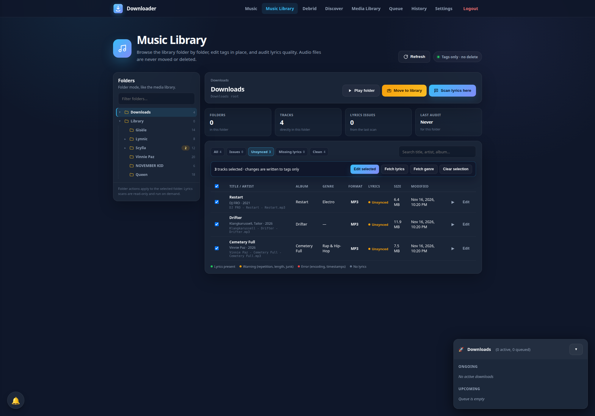
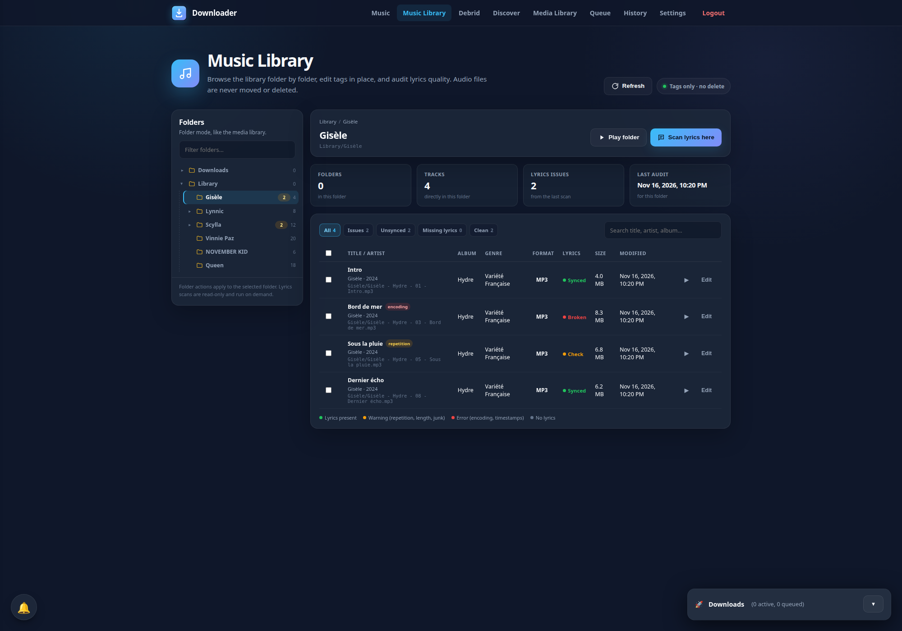
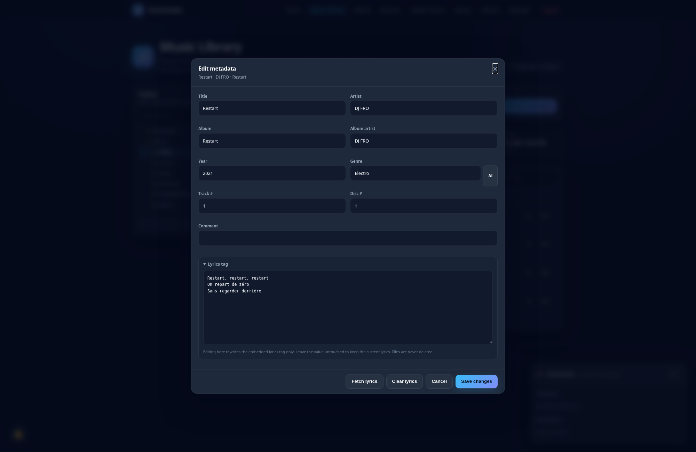
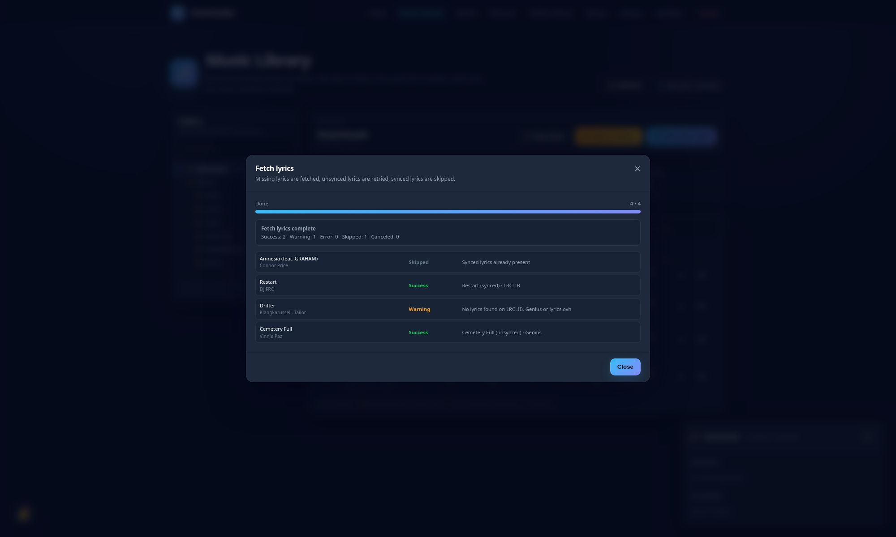
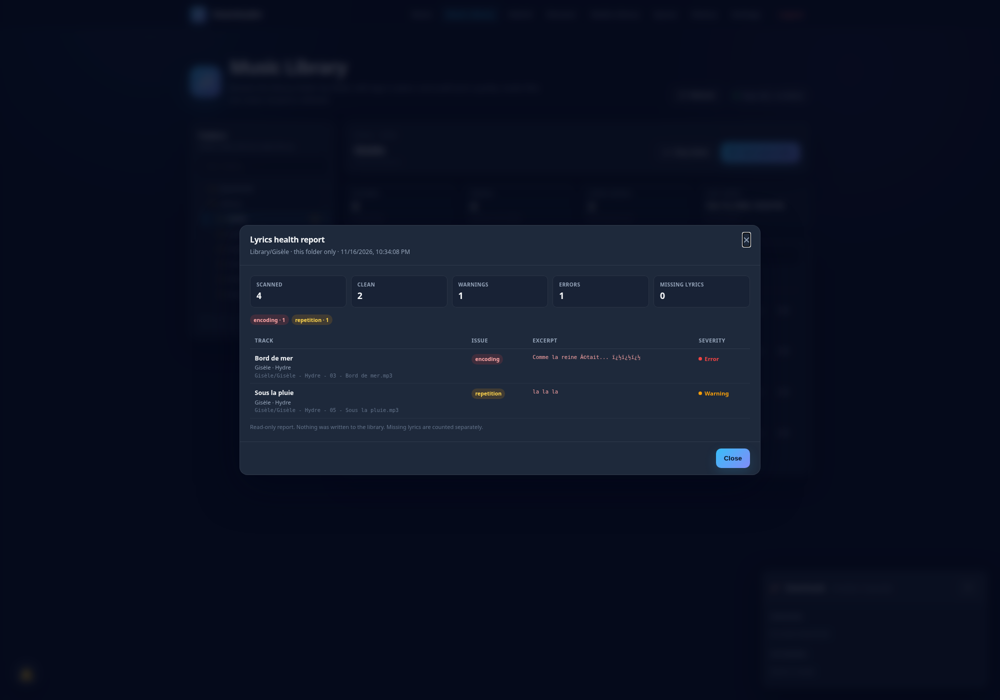

# Downloader 2.7 — Music Library

> Une seule bibliothèque musicale pour parcourir, corriger, écouter et auditer vos morceaux — sans jamais toucher aux fichiers en dehors de l'action de rangement.

La 2.7 fusionne **Music Downloads** et **Music Library** dans un seul espace de travail. Les deux racines cohabitent au même niveau, les métadonnées se modifient à l'unité ou en masse, les lyrics sont plus faciles à cibler et à réparer, et un lecteur simple accompagne la navigation.

Cette version apporte aussi les identifiants Jellyfin stables et les `ProviderIds` TVDB, ainsi que plusieurs correctifs de confort.



## Une seule section Music Library

L'ancien écran **Music Downloads** est remplacé par **Music Library**. L'URL `/music-files` redirige automatiquement vers `/music-library?root=downloads` pour conserver les anciens signets.

- **Deux racines au même niveau** dans l'arbre : `Downloads` (`music_root_path`) et `Library` (`music_library_path`).
- **Navigation dossier par dossier** avec chargement à la demande, fil d'Ariane, sous-dossiers et compteurs.
- **Colonne Genre** sur tous les dossiers.
- Filtres **All / Issues / Unsynced / Missing lyrics / Clean**.
- Sélection multiple avec actions **Edit selected**, **Fetch lyrics**, **Fetch genre** et **Clear selection**.
- **Move to library** n'apparaît que sur la racine `Downloads`.
- Lecteur simple : lecture d'une piste ou du dossier, précédent/suivant, seek, volume, fermeture.
- La sélection et la barre d'actions restent visibles au scroll.



## Édition des métadonnées

La popup d'édition affiche désormais **Titre · Artiste · Album** et permet de modifier :

- titre, artiste, album, album artist ;
- année, genre, numéro de piste, numéro de disque, commentaire ;
- lyrics embarquées.

L'édition fonctionne à l'unité ou en masse. En édition simple, seuls les champs réellement modifiés sont écrits. Les champs numériques vidés sont effacés proprement. Le bouton **AI** reste aligné avec le champ Genre.

Actions disponibles dans la popup :

- **Fetch lyrics** ;
- **Clear lyrics** ;
- **AI genre**.

Aucune action de cette section ne supprime, déplace ou renomme un fichier. Seule l'action explicite **Move to library** déplace les fichiers de `Downloads` vers `Library` avec la nomenclature existante.



## Lyrics plus fiables

La recherche de lyrics a été revue :

- **LRCLIB** est désormais interrogé via `/get` puis `/search`, avec un score sur le titre, l'artiste, l'album et la durée.
- Les candidats trop éloignés sont écartés par un seuil de confiance.
- Les lyrics `plain` de LRCLIB peuvent servir de fallback unsynced.
- Chaîne de fournisseurs : **LRCLIB → Genius → lyrics.ovh**.
- Le fournisseur et le score de confiance sont remontés dans le résultat.
- Les lyrics **synced** sont ignorés lors d'un fetch.
- Les lyrics **unsynced** sont retentés avec `--force-dl-unsync`.
- La détection des timestamps est stricte : `[mm:ss.xx]` et `<mm:ss.xx>` uniquement, sans confondre `[Refrain :]` avec un timestamp.
- Sur MP3, l'ancien frame `USLT` est supprimé avant écriture pour éviter les doublons.

Deezer n'est pas utilisé : son endpoint lyrics public exige désormais OAuth. `lyrics.ovh` sert uniquement de dernier recours unsynced.



## Audit lyrics par dossier

L'audit reste **lecture seule** et se lance à la demande sur un dossier, avec ou sans sous-dossiers.

- Détection encoding / mojibake ;
- timestamps LRC invalides ou non monotones ;
- HTML, entités, JSON, URLs et boilerplate ;
- répétition / lignes dupliquées ;
- longueur anormale, trop courte ou trop longue ;
- lyrics manquantes.

Le rapport affiche les compteurs, les types d'issues, les extraits et la sévérité. Les résumés sont mis en cache par racine et par dossier pour afficher les badges et compteurs sans relancer un scan.

Les modifications de tags et les fetch/clear lyrics invalident l'entrée d'audit du fichier et recalculent les compteurs concernés.



## Jellyfin

- Identifiants de séries stables basés sur TMDB puis IMDb, avec fallback `folder:`/`title:`.
- Les anciens IDs `folder:` restent résolus pour ne pas casser une bibliothèque Nuvio déjà synchronisée.
- `ProviderIds` expose désormais **Tmdb**, **Imdb** et **Tvdb** lorsqu'un profil de numérotation TVDB existe.
- La recherche de séries peut renvoyer des candidats pour vérification par identifiant externe lorsque le titre local diffère.

## Sécurité et qualité

- Chemins confinés à leur racine respective, avec rejet des traversées et des symlinks sortants.
- Streaming root-aware pour `Downloads` et `Library`.
- CSRF et authentification inchangés sur toutes les nouvelles routes.
- Les routes longues ne conservent plus le lock de session pendant les scans.
- Les listings de dossiers sont servis sans cache navigateur pour refléter immédiatement les changements.
- Le player conserve un comportement sticky propre avec `overflow: clip`.
- Les fichiers audio ne sont jamais supprimés par l'éditeur de métadonnées ou l'audit.

## Mise à jour

Image Docker :

```bash
docker pull gautardos/downloader-app:2.7.0
```

Ou avec le compose fourni :

```env
IMAGE_TAG=2.7.0
```

Aucune migration manuelle n'est nécessaire. Les chemins musique existants continuent de fonctionner. Les nouveaux cache d'audit sont créés automatiquement dans `var/storage/music_library_audits.json`.

## Limites assumées

- Le fetch de lyrics gère toujours uniquement **MP3** et **M4A**.
- L'audit lyrics est synchrone et lancé à la demande ; les très gros dossiers récursifs peuvent être longs.
- Le fetch genre applique d'abord le mapping existant ; l'IA n'intervient que lorsque le genre est vide ou inconnu.
- Deezer lyrics n'est pas intégré faute d'accès public sans OAuth.
- `lyrics.ovh` est un fallback unsynced de dernier recours, avec une couverture variable.

## Remerciements

Merci à toutes les personnes qui testent les bibliothèques réelles, signalent les faux positifs d'audit et permettent d'affiner les heuristiques de matching. La 2.7 rend enfin la bibliothèque musicale agréable à parcourir, corriger et écouter au quotidien.
