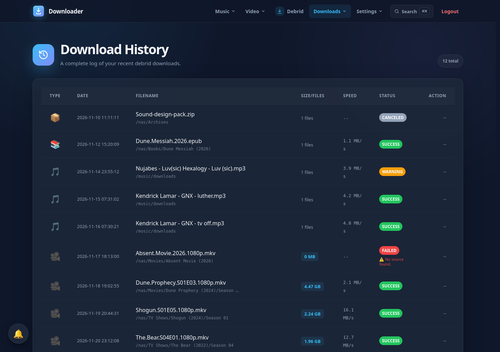
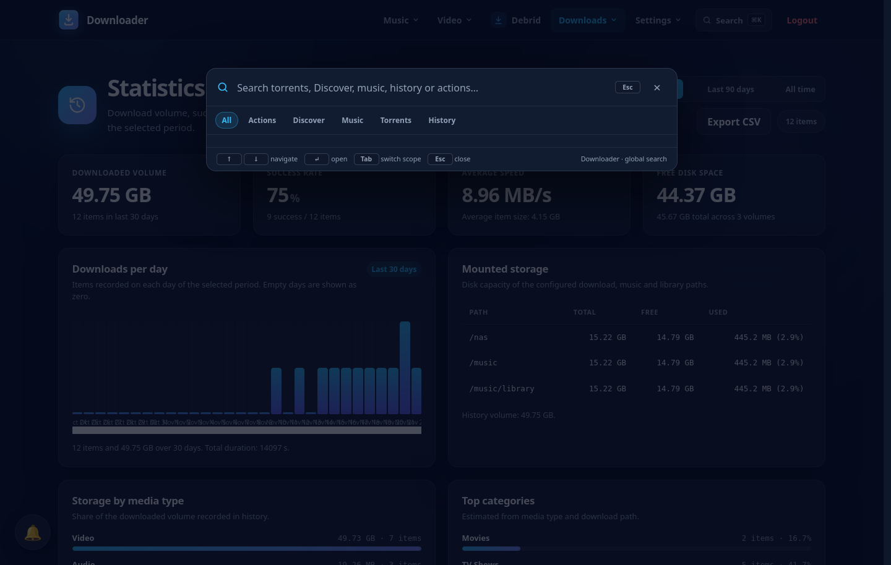
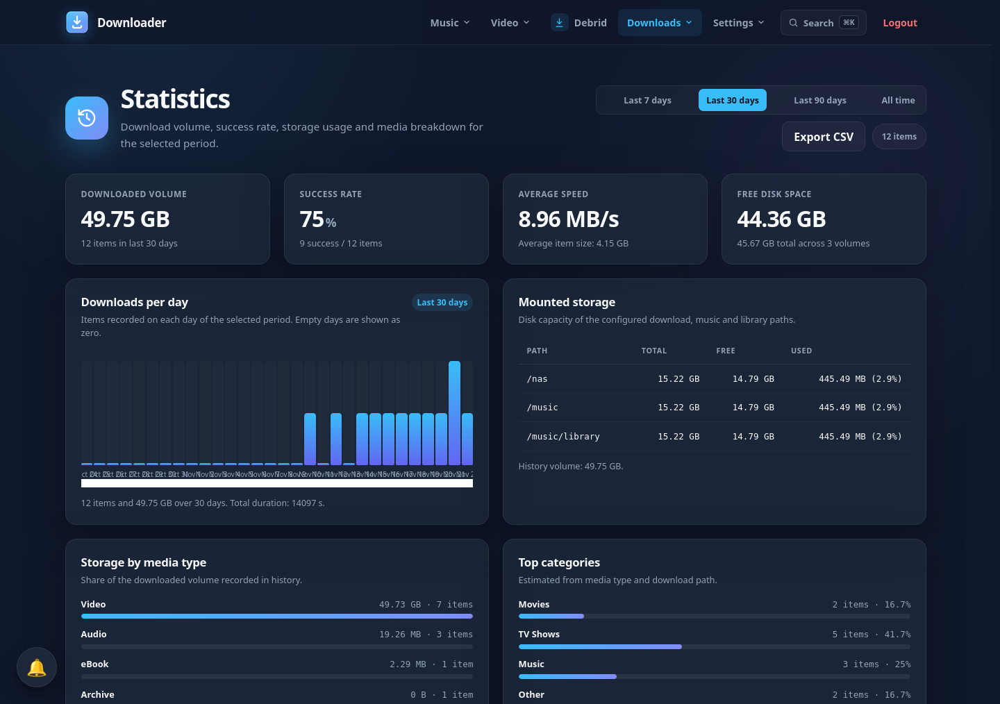
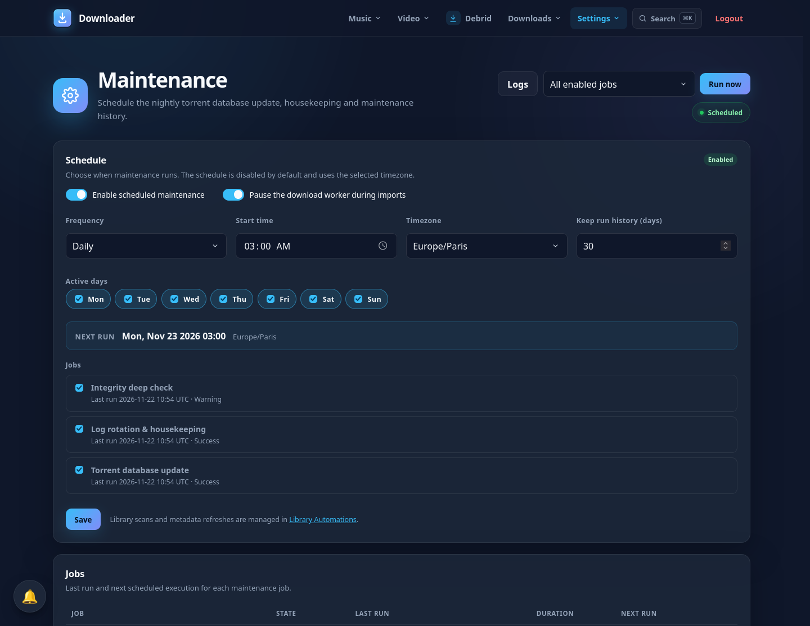
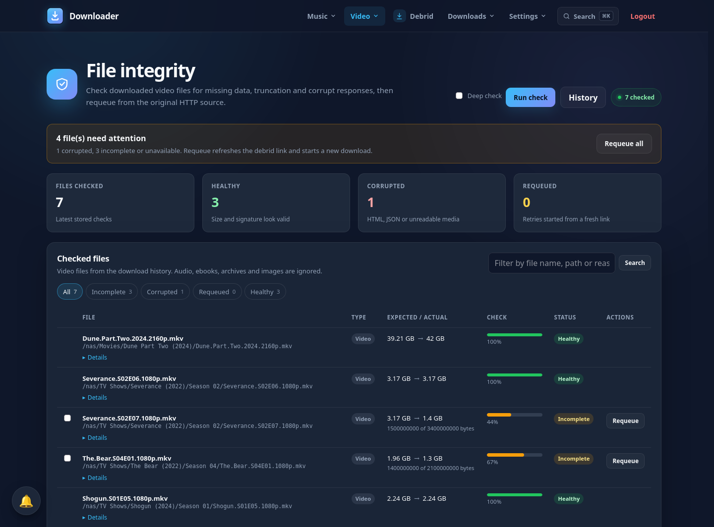
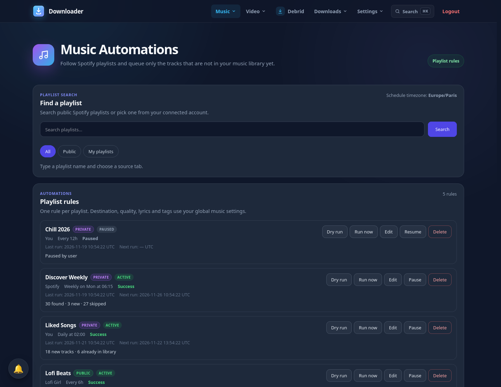
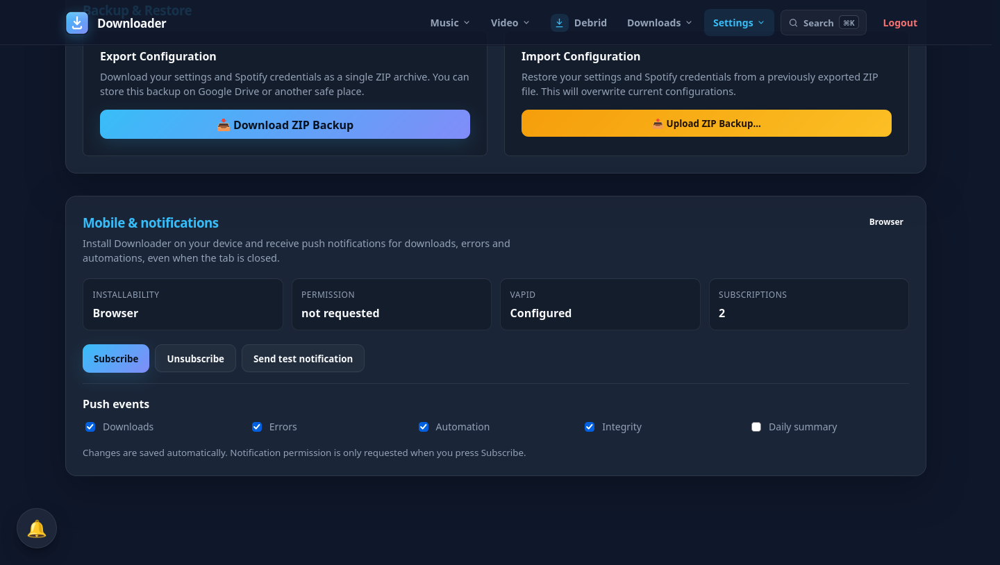
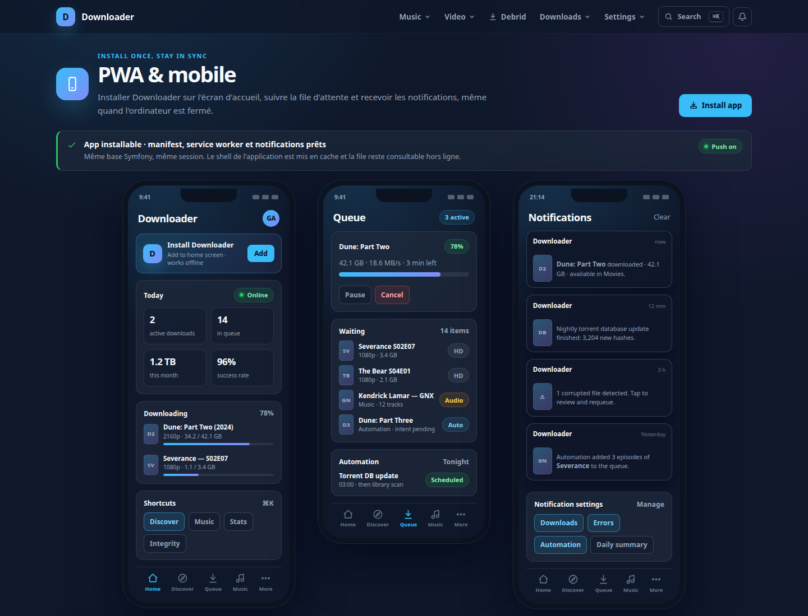

# Downloader 2.8.4 — Release consolidée 2.8.x

Cette release **consolide 2.8.0, 2.8.1, 2.8.2, 2.8.3 et 2.8.4** en une seule
version de référence. Elle conserve l'ensemble des fonctionnalités des sept lots
2.8, les mises à jour de sécurité/dépendances, le build Docker optimisé et les
tests de non-régression musique, le correctif de permissions de l'entrypoint,
puis ajoute l'extension du contrôle d'intégrité vidéo à la bibliothèque.

Aucune migration manuelle n'est nécessaire : la logique applicative, les routes,
le CSRF, l'authentification et les formats de données restent compatibles avec
les versions 2.8.x précédentes.

## Nouveautés 2.8.4 — Intégrité étendue à la bibliothèque

- Le scan d'intégrité couvre désormais l'historique de téléchargement **et** les
  fichiers vidéo actifs de l'index Automation (`library_entries`). Les fichiers
  déjà présents sur le NAS sont détectés même s'ils n'ont jamais été
  téléchargés par l'application.
- Dédoublonnage par chemin : une entrée d'historique et une entrée
  bibliothèque partagent le même contrôle. L'historique fournit alors
  `download_id`, la taille attendue et la source.
- Nouveaux contrôles ciblés **Check integrity** dans Connected Lists et dans la
  fiche Discovery de Library Browser, avec filtres `show_folder` / `tmdb_id`.
- Les fichiers sans source connue affichent « source inconnue » ; le requeue
  automatique est désactivé pour eux.
- La page Integrity indique la provenance du contrôle (`History`, `Library` ou
  `History + Library`).
- `app:integrity-check` accepte `--history-only`, `--show` et `--tmdb` en plus
  des options existantes.

## Correctif 2.8.3 — permissions, entrypoint et journaux

- `var/` et `vendor/` appartiennent désormais à `www-data` **dans l'image**
  (chown non récursif à la construction). L'entrypoint ne déclenche donc plus
  le `chown -R` coûteux qui traversait `var/db`, `var/home`, `var/storage` et
  les 365 Mo de `vendor/` à chaque démarrage.
- Le fallback de l'entrypoint (si `var/` ou `vendor/` est encore root-owned)
  prune explicitement les points de montage Docker lus dans `/proc/mounts`, en
  plus de `-xdev`. Les groupes des volumes de données de l'hôte sont préservés,
  notamment celui de `var/storage` utilisé par l'agent de logs.
- Les fichiers `music_automations_worker_error.log` et `maintenance_error.log`
  sont pré-créés comme les deux autres logs Supervisor (`touch`, chown
  `www-data`, groupe hérité de `var/storage/logs`, permissions `640`).
- Vérifié sur l'image : `var` et `vendor` sont `www-data`; 6/6 workers
  Supervisor `RUNNING`.

## Sécurité et dépendances (2.8.1)

Correctif de sécurité et de maintenance des dépendances, sans changement
fonctionnel ni migration de données.

- **Symfony 6.3 (EOL) → 6.4 LTS** : `console`, `dotenv`, `framework-bundle`,
  `process`, `runtime`, `twig-bundle`, `yaml` et les composants transitifs
  (`http-foundation`, `http-kernel`, `routing`, `cache`, `config`, `filesystem`)
  sont résolus en 6.4.x (composants jusqu'à 6.4.50).
- **Twig 3.23 → 3.30**, **Guzzle 7.10 → 7.16.5**, **PSR-7 2.8 → 2.13.6**.
- `minishlink/web-push` reste en 10.1 (à jour). PHP requis inchangé (8.1+) ;
  l'image reste `php:8.3-apache`.
- Imports `Symfony\Component\Routing\Annotation\Route` migrés vers
  `Symfony\Component\Routing\Attribute\Route`.
- `framework.php_errors.log` est désormais explicite, ce qui supprime la
  dépréciation Symfony 6.4.
- **`composer audit` : 0 avis** (contre 48 avis sur 12 paquets avant montée).

## Nouveautés 2.8.x

### Navigation groupée et recherche globale

- Nouvelle barre de navigation en cinq groupes : **Music**, **Video**, **Debrid**,
  **Downloads**, **Settings**.
- Palette de recherche globale (`Ctrl/Cmd+K`) sur les actions, torrents,
  historique, TMDB et Spotify, avec résultats normalisés et liens
  internes/Spotify uniquement.
- Les providers distants ne sont appelés que si TMDB/Spotify est configuré ;
  une panne d'un provider rend les résultats partiels sans bloquer les autres.





### Statistiques

- Page `/statistics` avec périodes `7d`, `30d`, `90d` et tout l'historique.
- Agrégats de téléchargements, erreurs, volumes et activité récente.
- Export CSV via `/statistics/export`.



### Maintenance planifiée

- Page `/settings/maintenance` : planification, jobs, derniers runs, extrait de
  log.
- Jobs : mise à jour de la base torrents, rotation des logs, contrôle
  d'intégrité.
- Nouveau worker Supervisor `maintenance-worker` (`app:maintenance --loop`).
- Rétention configurable des runs, verrou d'exécution et mode pause.



### Intégrité vidéo

- Page `/video/integrity` : fichiers sains, incomplets, corrompus, manquants,
  hors racine ou non supportés.
- Scan rapide ou profond (`ffprobe` optionnel), détection des faux fichiers
  (HTML/JSON) et des tailles incohérentes.
- Remise en file contrôlée : plafond de tentatives, limite de lot,
  déduplication, `dry_run`, sources `http(s)` ou `magnet` uniquement.
- Depuis 2.8.4, le scan inclut aussi les fichiers de la bibliothèque
  Automation et propose des contrôles ciblés par série ou TMDB ID.
- Commande `app:integrity-check` et prise en charge des anciennes entrées
  d'historique sans `source_url` (fallback `original_url`).



### Automatisations musicales Spotify

- Page `/music/automations` : suivi de playlists publiques ou privées,
  recherche, règles par playlist et exécution manuelle en dry-run ou enqueue.
- Fréquences `daily`, `weekly`, `6h`, `12h`, avec heure, journée et fuseau.
- Matching avec la bibliothèque taguée, cap par exécution (50) et garde-fou de
  file (20), réutilisation du pipeline musique existant.
- Nouveau worker Supervisor `music-automations-worker`
  (`app:music-automations --loop`).



### PWA, hors-ligne et notifications push

- Application installable : manifeste, icônes 192/512/maskable, `theme-color`,
  scope `/` et raccourcis Queue/Discover/Music/Debrid.
- Service worker avec coquille hors-ligne (`/offline.html` + **Retry**) et
  navigation réseau d'abord.
- Web Push VAPID : abonnement, désabonnement, test, préférences par catégorie
  (téléchargements, erreurs, automatisations, intégrité, résumé quotidien).
- Les routes sensibles (`/jellyfin`, `/login`, `/logout`, `/pwa/*`,
  `/queue-status`, `/notifications-poll`, `/search/global`, JSON/API) ne sont
  jamais mises en cache.
- Les endpoints push sont limités aux hôtes officiels
  FCM/Mozilla/Apple/Microsoft ; la clé privée VAPID reste dans
  `var/storage/pwa_vapid.json` (0600).





## Build, cache et fiabilité Docker (2.8.2)

- **Layer cache optimisé** : base/Apache/PHP → Rust → Python → Composer vendor →
  source → Composer final/scripts → `var/` → supervisord/entrypoint.
  Une modification PHP ne reconstruit et ne pousse plus que les petites couches
  source, Composer final et `var/`.
- **Rust épinglé** : `librespot-auth` est compilé depuis
  `f16fa8ad7159aff6af4933fd782707c8e876fc8c` (`ARG LIBRESPOT_AUTH_REF`).
  Le binaire est marqué exécutable juste après `cargo build`; la couche
  `find ... chmod +x` tardive a été supprimée.
- **Python cache-bust** : `cli/requirements.txt` est copié seul, le venv est
  installé dans `/opt/venv`, avec `ARG PYTHON_DEPS_CACHE_BUST=1`.
- **Zotify épinglé** :
  `git+https://github.com/Gautardos/zotify.git@6e45c5ff9b504583d2c5223442baf788bf95be09`.
- **Vendor séparé du source** : dépendances installées avant la copie du code,
  puis autoloader classmap-authoritative et scripts Symfony dans une couche
  dédiée.
- Couches `chown` tardives limitées à quelques Mo ; image finale autour de
  1,33 Go (au lieu de 5,5 Go pour les anciennes images).

### Mesures build 2.8.4

Mesure sur le build incrémental depuis l'image 2.8.3, avec cache de couches :

- Temps de build : **33,8 s**.
- 11 nouvelles couches (source, templates, `composer install` final, dossiers
  runtime, configuration finale).
- **2,10 MiB** de blobs compressés à uploader, plus le manifeste et la config
  (quelques Ko).
- Les couches lourdes (librespot-auth, venv Python, vendor Composer, paquets
  système) sont intégralement réutilisées depuis le cache.
- Taille d'image inchangée : **3,98 Go** ; push des trois tags en **11 s**.

## Tests de non-régression musique (2.8.2)

Nouvelle suite `composer test:music-runtime`, intégrée à `test:functional` et
`test:all` :

- `tests/librespot_auth_smoke.php` : faux binaire, transformation des
  credentials, JSON invalide, fichier absent, exit non-zéro, timeout, injection
  d'arguments.
- `tests/music_downloader_command_smoke.php` : mapping complet des flags Zotify,
  fallback qualité, booléens et `MusicTrackVerifier`.
- `tests/music_downloader_smoke.py` : `lyrics_are_synced`, `safe_tag`,
  `--verify`, `--tags`/`--update-tags`, vidage de tag numérique et wrapper
  `music_binary`.
- `tests/spotify_user_smoke.py` : mapping playlists/pistes, pagination,
  filtrage `is_local`, `snapshot_id`, fallbacks 401/403/429.
- `tests/docker_music_runtime_smoke.sh` : validation de l'image réelle
  (librespot-auth exécutable, import zotify épinglé, `--verify` vide,
  `spotify_user.py --help`), hors `test:all`.

Tous les tests utilisent des fakes/monkeypatches : aucun vrai compte Spotify,
aucun vrai téléchargement Zotify et aucun vrai `librespot-auth` dans les suites
automatisées. L'authentification Spotify réelle a été validée manuellement avec
le binaire de l'image et un HOME temporaire.

## Tests d'intégrité étendue (2.8.4)

- `composer test:functional` : OK.
- `tests/integrity_smoke.php` : 167 tests OK, dont scan bibliothèque seul,
  dédoublonnage historique/bibliothèque et requeue sans source.
- `lint:twig` et `lint:container` : OK.
- Validation réelle en dry-run : Rurouni Kenshin (47/47 fichiers détectés),
  Gachiakuta (24 fichiers, 11 incomplets).

## Exploitation

- `supervisorctl` fonctionne dans le conteneur (socket Unix + RPC).
- L'entrypoint crée `var/storage/logs/` sur un volume neuf avant de lancer
  Supervisor, ce qui évite un échec de démarrage des workers.
- Les quatre logs d'erreur Supervisor (`worker`, `automation_worker`,
  `music_automations_worker`, `maintenance`) sont pré-créés en `640`.
- Les icônes PWA sont servies depuis `/pwa-icons/` (le chemin `/icons/` est
  réservé par l'alias Apache de Debian).
- `var/db` contient `maintenance.db`, `integrity.db`, `music_automations.db` et
  `pwa.db`, en plus de `torrents.db` et `automation.db`. Toutes les bases
  utilisent WAL, `busy_timeout` et des initialisations idempotentes.
- Nouveautés de configuration : `music_automation_timezone` (UTC par défaut),
  `music_automation_max_per_run` (50) et `music_automation_queue_guard` (20).
  Les réglages de maintenance/intégrité et les préférences push sont stockés
  dans leurs bases dédiées.

## Mise à jour

Aucune migration manuelle n'est nécessaire. Les bases et dossiers manquants sont
créés automatiquement. Sauvegardez avant mise à jour `var/storage/`, `var/db/`,
`var/home/` et `var/.env.local`. Les anciennes URLs `/debrid` et `/music-files`
continuent de rediriger vers `/torrent` et `/music-library`.

```bash
IMAGE_TAG=2.8.4 docker compose pull
IMAGE_TAG=2.8.4 docker compose up -d
```

Ou avec le Compose fourni :

```env
IMAGE_TAG=2.8.4
```

Les tags `2.8` et `latest` pointent sur 2.8.4. Les tags `2.8.3`, `2.8.2` et
`2.8.1` restent disponibles comme images historiques, mais 2.8.4 est
recommandé.

## Docker Hub

- `gautardos/downloader-app:2.8.4`, `:2.8` et `:latest` sont publiés ensemble.
- Digest : `sha256:5e68e02611164c4a4df87f2d851b1553c94b72345f39891f0f2f3621b6a9a62f`.
- L'image `:2.8.1` n'a jamais pu être publiée (push instable / erreurs 502).
- Les images `:2.8.2` et `:2.8.3` restent disponibles comme versions
  historiques ; 2.8.4 les remplace.

## Limites connues

- **PWA / Web Push** nécessitent HTTPS ou `localhost`. En HTTP sur une IP du LAN,
  l'installation, le service worker et le push restent désactivés.
- Le fuseau des automatisations musicales se règle pour l'instant via
  `config.json` (`music_automation_timezone`), pas dans l'interface.
- L'installation PWA dépend du navigateur : Chrome/Edge exposent
  `beforeinstallprompt` ; iOS Safari passe par **Partager → Sur l'écran
  d'accueil**.
- La passerelle Jellyfin reste direct-play uniquement (pas de transcodage).
- `librespot-auth` et Zotify réels ne sont pas utilisés par les tests
  automatisés ; l'image publiée reste le lieu de validation de l'interopérabilité.
- Un fichier bibliothèque sans entrée d'historique source ne peut pas être remis
  en file automatiquement ; il reste contrôlable et visible dans Integrity.
- Pour un fichier bibliothèque seul, la taille attendue vient de
  `library_entries.size`. Une troncature antérieure au premier scan ne peut pas
  toujours être déduite de la taille, mais les contrôles de signature, de taille
  minimale et `--deep` restent appliqués.
