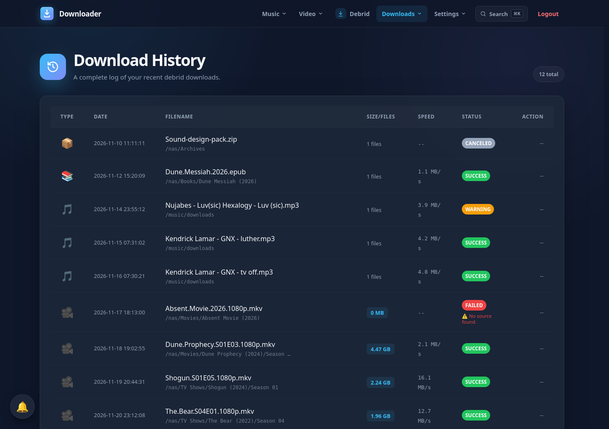
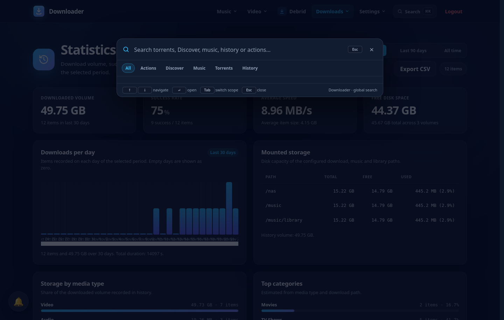
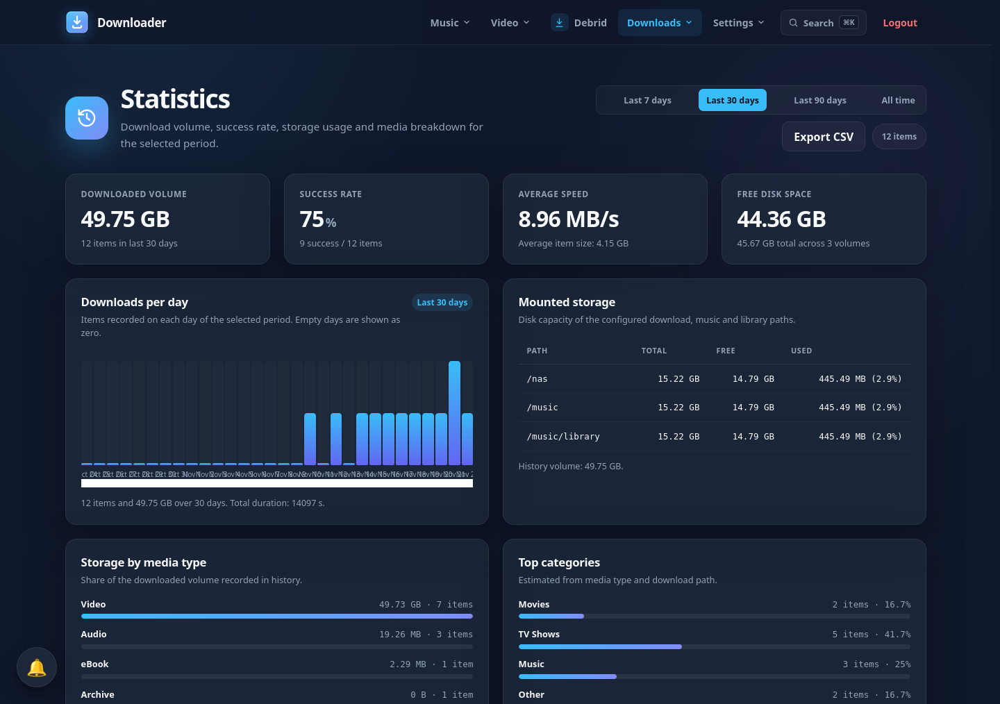
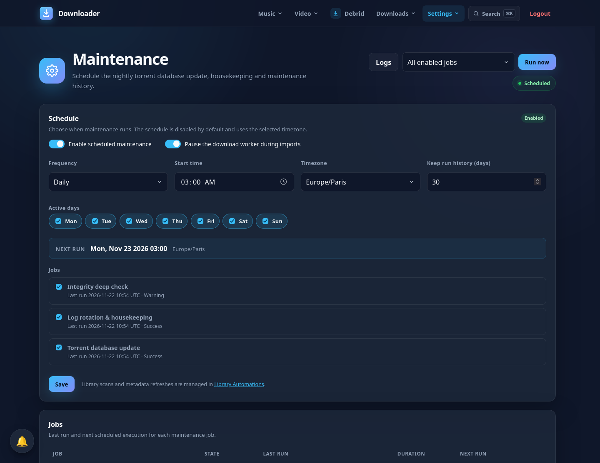
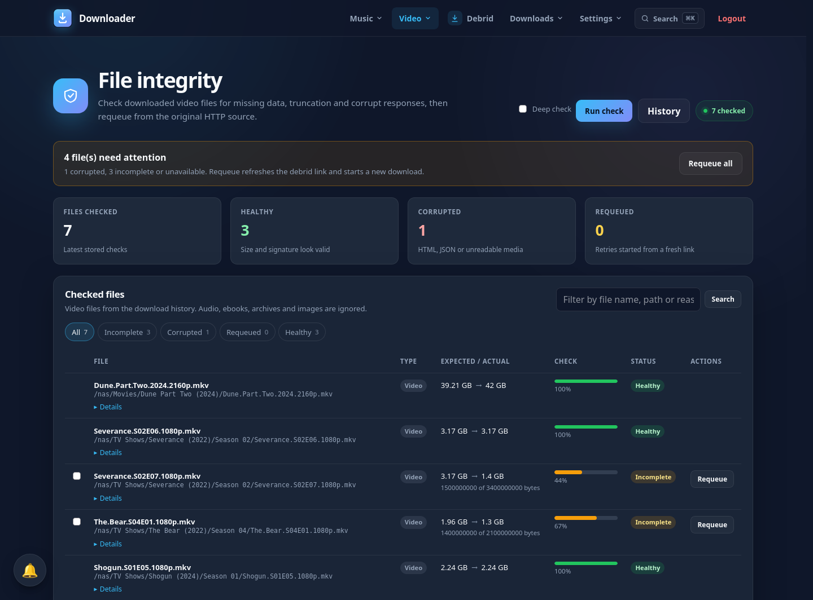
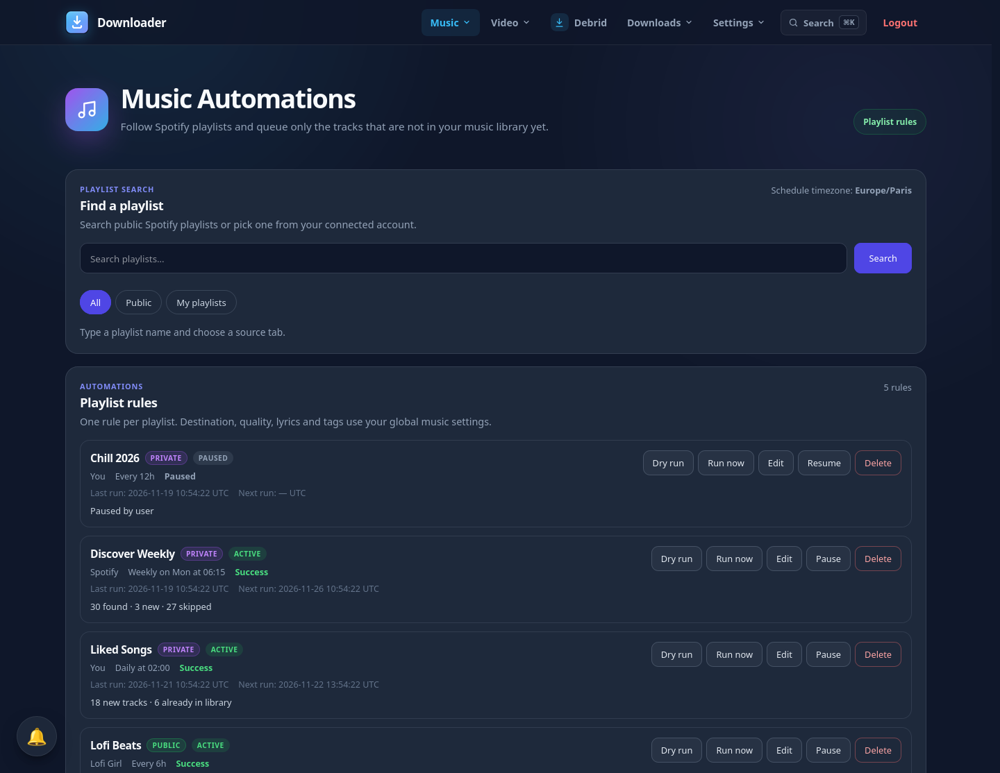
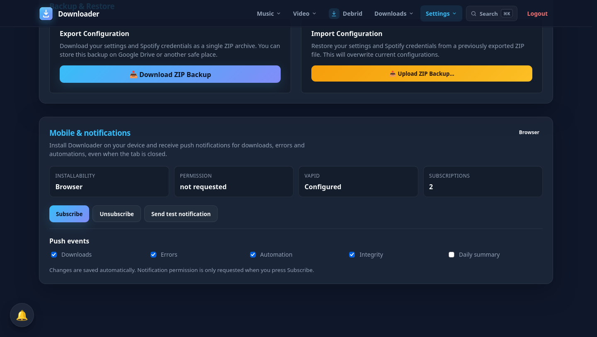
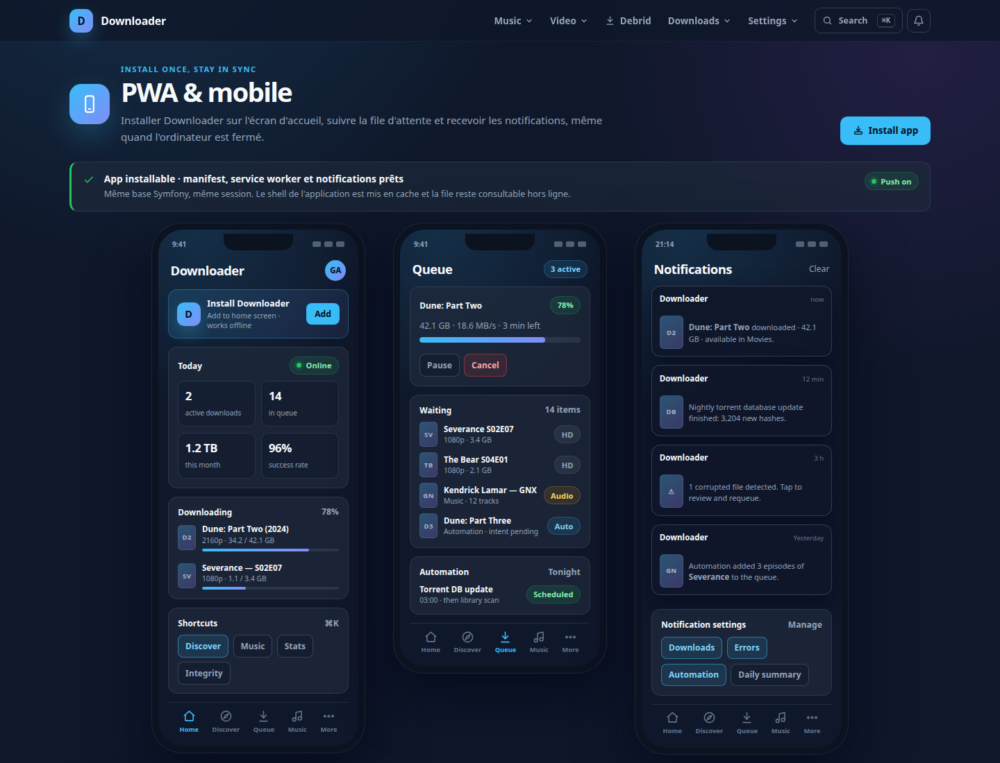

# Downloader 2.8.1 — Recherche, statistiques, maintenance, intégrité, musique et PWA

Cette version regroupe sept lots fonctionnels : navigation/recherche globale,
statistiques, maintenance planifiée, intégrité vidéo, automatisations musicales
Spotify, PWA/Web Push et les ajustements d'exploitation associés.

## Sécurité 2.8.1

Correctif de sécurité et de maintenance des dépendances, sans changement
fonctionnel ni migration de données.

- **Symfony 6.3 (EOL) → 6.4 LTS** : `console`, `dotenv`, `framework-bundle`,
  `process`, `runtime`, `twig-bundle`, `yaml` et les composants transitifs
  (`http-foundation`, `http-kernel`, `routing`, `cache`, `config`, `filesystem`)
  sont résolus en 6.4.x (composants jusqu'à 6.4.50).
- **Twig 3.23 → 3.30**, **Guzzle 7.10 → 7.16.5**, **PSR-7 2.8 → 2.13.6**.
- `minishlink/web-push` reste en 10.1 (à jour). PHP requis inchangé (8.1+) ;
  l'image reste `php:8.3-apache`.
- Imports `Symfony\Component\Routing\Annotation\Route` migrés vers
  `Symfony\Component\Routing\Attribute\Route`.
- `framework.php_errors.log` est désormais explicite, ce qui supprime la
  dépréciation Symfony 6.4.
- **`composer audit` : 0 avis** (contre 48 avis sur 12 paquets avant montée).
- Validation : `composer test:all` vert (174 assertions), image 2.8.1
  construite, 6/6 workers Supervisor `RUNNING`, routes et assets PWA inchangés.

## Nouveautés

### Navigation groupée et recherche globale
- Nouvelle barre de navigation en cinq groupes : **Music**, **Video**, **Debrid**,
  **Downloads**, **Settings**.
- Palette de recherche globale (`Ctrl/Cmd+K`) sur les actions, torrents, historique,
  TMDB et Spotify, avec résultats normalisés et liens internes/Spotify uniquement.
- Les providers distants ne sont appelés que si TMDB/Spotify est configuré ; une
  panne d'un provider rend les résultats partiels sans bloquer les autres.





### Statistiques
- Page `/statistics` avec périodes `7d`, `30d`, `90d` et tout l'historique.
- Agrégats de téléchargements, erreurs, volumes et activité récente.
- Export CSV via `/statistics/export`.



### Maintenance planifiée
- Page `/settings/maintenance` : planification, jobs, derniers runs, extrait de log.
- Jobs : mise à jour de la base torrents, rotation des logs, contrôle d'intégrité.
- Nouveau worker Supervisor `maintenance-worker` (`app:maintenance --loop`).
- Rétention configurable des runs, verrou d'exécution et mode pause.



### Intégrité vidéo
- Page `/video/integrity` : fichiers sains, incomplets, corrompus, manquants,
  hors racine ou non supportés.
- Scan rapide ou profond (`ffprobe` optionnel), détection des faux fichiers
  (HTML/JSON) et des tailles incohérentes.
- Remise en file contrôlée : plafond de tentatives, limite de lot, déduplication,
  `dry_run`, sources `http(s)` ou `magnet` uniquement.
- Commande `app:integrity-check` et prise en charge des anciennes entrées
  d'historique sans `source_url` (fallback `original_url`).



### Automatisations musicales Spotify
- Page `/music/automations` : suivi de playlists publiques ou privées, recherche,
  règles par playlist et exécution manuelle en dry-run ou enqueue.
- Fréquences `daily`, `weekly`, `6h`, `12h`, avec heure, journée et fuseau.
- Matching avec la bibliothèque taguée, cap par exécution (50) et garde-fou de
  file (20), réutilisation du pipeline musique existant.
- Nouveau worker Supervisor `music-automations-worker`
  (`app:music-automations --loop`).



### PWA, hors-ligne et notifications push
- Application installable : manifeste, icônes 192/512/maskable, `theme-color`,
  scope `/` et raccourcis Queue/Discover/Music/Debrid.
- Service worker avec coquille hors-ligne (`/offline.html` + **Retry**) et
  navigation réseau d'abord.
- Web Push VAPID : abonnement, désabonnement, test, préférences par catégorie
  (téléchargements, erreurs, automatisations, intégrité, résumé quotidien).
- Les routes sensibles (`/jellyfin`, `/login`, `/logout`, `/pwa/*`,
  `/queue-status`, `/notifications-poll`, `/search/global`, JSON/API) ne sont
  jamais mises en cache.
- Les endpoints push sont limités aux hôtes officiels FCM/Mozilla/Apple/Microsoft ;
  la clé privée VAPID reste dans `var/storage/pwa_vapid.json` (0600).





## Exploitation

- `supervisorctl` fonctionne désormais dans le conteneur (socket Unix + RPC).
- L'entrypoint crée `var/storage/logs/` sur un volume neuf avant de lancer
  Supervisor, ce qui évite un échec de démarrage des workers.
- Les icônes PWA sont servies depuis `/pwa-icons/` (le chemin `/icons/` est
  réservé par l'alias Apache de Debian).
- `var/db` contient désormais `maintenance.db`, `integrity.db`,
  `music_automations.db` et `pwa.db`, en plus de `torrents.db` et
  `automation.db`. Toutes les bases utilisent WAL, `busy_timeout` et des
  initialisations idempotentes.
- Nouveautés de configuration : `music_automation_timezone` (UTC par défaut),
  `music_automation_max_per_run` (50) et `music_automation_queue_guard` (20).
  Les réglages de maintenance/intégrité et les préférences push sont stockés dans
  leurs bases dédiées.

## Mise à jour

```bash
docker compose pull
docker compose up -d
```

Ou avec le Compose fourni :

```env
IMAGE_TAG=2.8.1
```

Aucune migration manuelle n'est nécessaire. Les bases et dossiers manquants sont
créés automatiquement. Sauvegardez avant mise à jour `var/storage/`, `var/db/`,
`var/home/` et `var/.env.local`. Les anciennes URLs `/debrid` et `/music-files`
continuent de rediriger vers `/torrent` et `/music-library`.

## Limites connues

- **PWA / Web Push** nécessitent HTTPS ou `localhost`. En HTTP sur une IP du LAN,
  l'installation, le service worker et le push restent désactivés.
- Le fuseau des automatisations musicales se règle pour l'instant via
  `config.json` (`music_automation_timezone`), pas dans l'interface.
- L'installation PWA dépend du navigateur : Chrome/Edge exposent
  `beforeinstallprompt` ; iOS Safari passe par **Partager → Sur l'écran d'accueil**.
- La passerelle Jellyfin reste direct-play uniquement (pas de transcodage).
